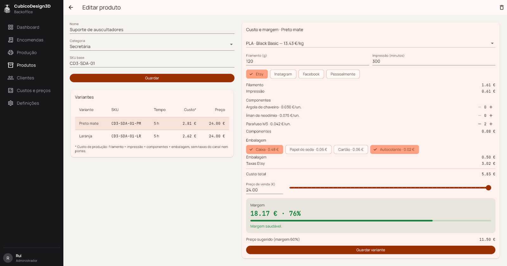
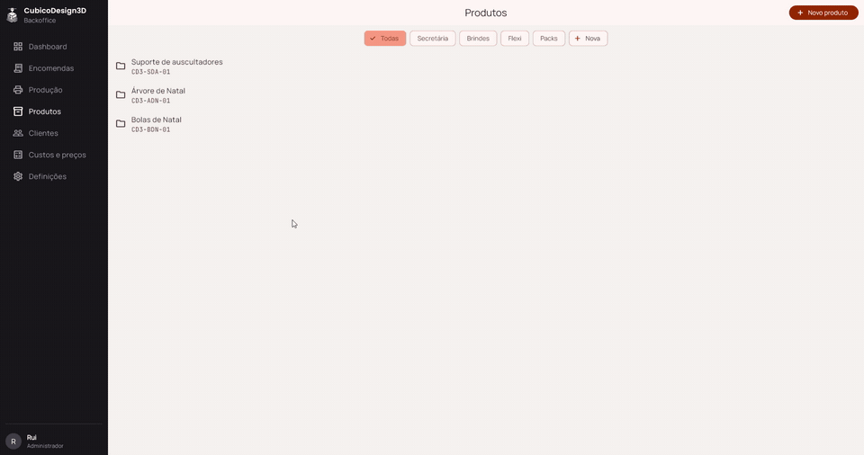
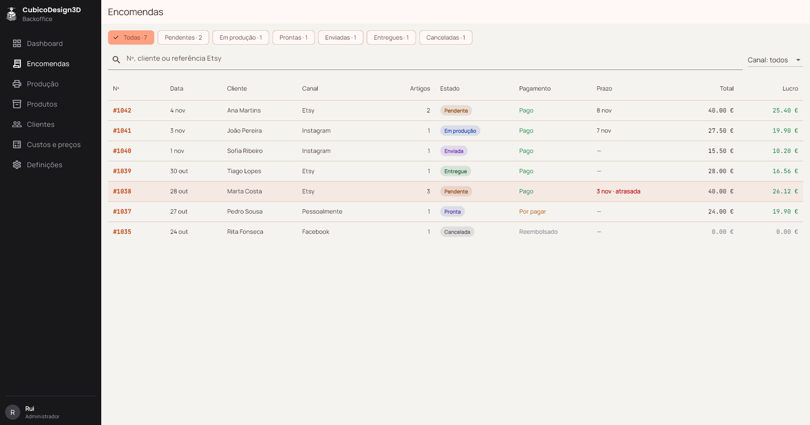
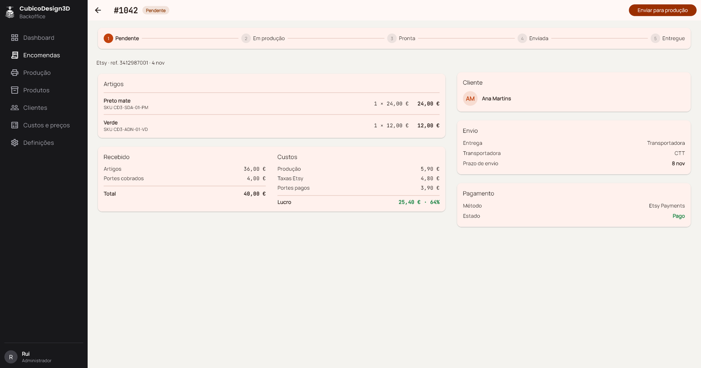

# CubicoDesign3D Backoffice

Backoffice para gerir uma pequena loja de impressão 3D: produtos e variantes, **custo real de cada peça**, preço sugerido com margem, e encomendas de vários canais (Etsy, Instagram, Facebook e venda em mão).

Feito em **Flutter** para **Windows** e Android. É um projeto real, para a minha loja, e o meu primeiro projeto de portfólio depois do curso de Flutter.

> **Estado:** em desenvolvimento, em modo demo (dados de exemplo em memória). A API em PHP + MySQL é a fase seguinte.





[▶ Ver o vídeo completo](docs/media/demo.mp4)

## O que faz

**Produtos**
- Categorias, produtos e variantes (cor, material), com criar, editar, apagar e filtrar.
- **Calculadora de custo em tempo real:** filamento (com a parte dos portes de cada rolo), luz e desgaste da impressora, componentes, embalagem e taxas do canal de venda.
- Margem com cores (saudável, abaixo do alvo, baixa), preço sugerido arredondado e barra para experimentar preços.
- Cada variante guarda a sua receita de produção; a tabela de variantes mostra o custo de cada uma.

**Encomendas**
- Lista com separadores por estado e contagens, pesquisa (nº, cliente ou referência Etsy) e filtro por canal.
- Encomendas atrasadas destacadas a vermelho.
- Detalhe com artigos, recebido, custos e **lucro real** (com as taxas da Etsy e os portes pagos), cliente, envio e pagamento.
- Fluxo de estados (Pendente → Em produção → Pronta → Enviada → Entregue) com um botão para avançar.

| Encomendas | Detalhe da encomenda |
|---|---|
|  |  |

## Tecnologias

| | |
|---|---|
| App | Flutter 3.47 · Dart 3 · `material_ui` |
| Estado | Riverpod 3 |
| Navegação | GoRouter 18 (`StatefulShellRoute`) |
| Modelos | Freezed + json_serializable |
| Testes | `flutter_test` |
| Backend (próxima fase) | PHP 8 (Slim) · MySQL · cPanel |

## Arquitetura

Organizada **por funcionalidade**, com três camadas em cada uma:

- `domain/` — modelos, contratos dos repositórios e regras de negócio (lucro, atraso, fluxo de estados);
- `data/` — repositórios (hoje dados demo em memória; na fase da API, chamadas HTTP);
- `presentation/` — ecrãs, widgets e providers.

Os ecrãs nunca sabem de onde vêm os dados: trocar o modo demo pela API real é mudar uma linha por repositório.
As contas de custo vivem numa classe Dart pura (`CostCalculator`), coberta por testes.

Mais detalhe em [`docs/architecture.md`](docs/architecture.md). Decisões, âmbito e esquema da base de dados em [`docs/cubico-backoffice.md`](docs/cubico-backoffice.md).

## Correr o projeto

Precisa de Flutter 3.47 ou mais recente. Para Windows, também do Visual Studio com "Desktop development with C++".

```bash
cd app
flutter pub get
dart run build_runner build
flutter run -d windows
```

Testes:

```bash
cd app
flutter test
```

Também há uma versão Windows pronta a usar, em modo demo, nos [Releases](../../releases).

## Plano

| | Fase | |
|:---:|---|---|
| ✅ | Esqueleto, tema e navegação responsiva | |
| ✅ | Produtos, categorias e variantes | |
| ✅ | Calculadora de custo e margem, com testes | |
| ✅ | Encomendas: lista, filtros, detalhe e estados | |
| ⬜ | Custos e preços (filamentos, energia, embalagens, canais) | |
| ⬜ | Criar encomenda manual, produção (kanban), dashboard | |
| ⬜ | Login com papéis (administrador / colaborador) | |
| ⬜ | API PHP + MySQL e sincronização com a Etsy | |

## O que aprendi

- Organizar um projeto real por funcionalidades e camadas, e escrever as decisões antes do código.
- Separar regras de negócio da interface, e testá-las com testes unitários.
- Gerir estado com Riverpod (`FutureProvider`, `family`, `Notifier`) e saber quando chega um `setState`.
- Layouts responsivos (menu lateral no PC, menu de baixo no telemóvel, duas colunas em ecrãs largos).
- Formulários com validação, e cuidados como desligar botões enquanto se grava e confirmar antes de apagar.
- Trabalhar com Git em commits pequenos e com mensagens claras.

## Autor

**Rui** · [@rsflecha](https://github.com/rsflecha)

<!-- Acrescentar aqui o link da loja Etsy e o LinkedIn, se quiseres -->
