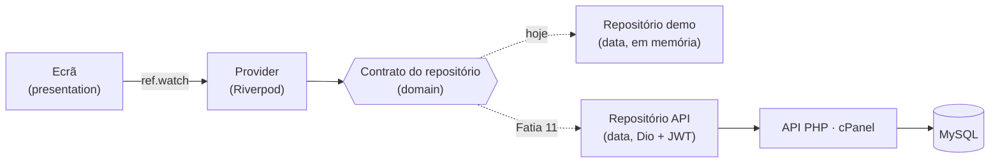

# Arquitetura — CubicoDesign3D Backoffice

Como a app está organizada, por onde passam os dados e onde fica cada coisa.
O âmbito, as decisões e o plano completo estão em [`cubico-backoffice.md`](cubico-backoffice.md).

**Última atualização:** 12/11/2026 — v1 completa, em modo demo e ligada à API (no PC); falta publicar no cPanel

---

## 1. Visão geral



Três regras resumem a arquitetura:

1. **Organizada por funcionalidade.** Tudo o que é de uma secção (encomendas, produtos…) vive na mesma pasta.
2. **Três camadas em cada funcionalidade**, e as dependências só vão num sentido: `presentation → domain ← data`.
3. **Os ecrãs nunca sabem de onde vêm os dados.** Pedem a um provider, que devolve um contrato. Trocar os dados demo pela API muda uma linha por repositório.

## 2. Pastas

```
cubico_backoffice/
├── app/                  app Flutter (Windows, Android, iOS)
│   ├── lib/
│   │   ├── main.dart     arranque: ProviderScope + App
│   │   ├── app/          o que é da app inteira
│   │   │   ├── app.dart          MaterialApp.router (tema + rotas)
│   │   │   ├── router.dart       todas as rotas
│   │   │   ├── theme.dart        cores, letras e estilos da marca
│   │   │   └── shell/app_shell.dart   menu lateral (PC) / menu de baixo (telemóvel)
│   │   └── features/     uma pasta por secção do menu
│   │       ├── dashboard/   orders/   production/   products/
│   │       └── customers/   costs/    settings/
│   └── test/             testes unitários, com a mesma árvore de lib/
├── api/                  API PHP 8 / Slim (Fase 3, ainda vazia)
├── database/             schema.sql (tabelas) e seed.sql (dados de arranque)
└── docs/                 documentação e ecrãs desenhados
```

## 3. As três camadas

| Camada | O que tem | Pode depender de |
|---|---|---|
| `domain/` | Modelos (Freezed), contratos dos repositórios, regras de negócio | nada da app (só Dart e Freezed) |
| `data/` | Implementações dos repositórios: `Demo…` agora, `Api…` na Fatia 11 | `domain` |
| `presentation/` | Ecrãs, widgets, providers e estado de ecrã | `domain` (e `data` só no provider que escolhe o repositório) |

**Onde fica cada tipo de código:**

- **Regras de negócio** (o que conta como atrasada, o passo seguinte de uma encomenda, o lucro) → getters no modelo, em `domain`. Exemplo: `Order.isOverdue`, `Order.nextStatus`, `Order.profit`.
- **Contas de custo** → `costs/domain/cost_calculator.dart`, Dart puro e testado.
- **Textos e cores para o ecrã** (o "Pendente" laranja, o "Pago" verde) → extensões em `presentation`. Exemplo: `orders/presentation/order_labels.dart`.

## 4. Funcionalidades feitas

```
features/
├── products/
│   ├── domain/        Product, ProductCategory, Variant (+ VariantFilament, VariantComponent)
│   │                  e os contratos ProductRepository, ProductCategoryRepository, VariantRepository
│   ├── data/          DemoProductRepository, DemoProductCategoryRepository, DemoVariantRepository
│   │                  (no demo, a foto fica num "data:" URI, sem servidor)
│   └── presentation/  products_screen      lista com filtro por categoria e miniatura da foto
│                      product_form_screen  criar / editar produto (duas colunas no PC), com a foto
│                      products_providers
│                      widgets/  category_dialog · cost_card · variants_section · product_photo
├── costs/
│   ├── domain/        Filament, Component, SalesChannel, Printer, CostSettings,
│   │                  CostCalculator e os contratos dos repositórios
│   ├── data/          Demo… de filamentos, componentes, canais, impressoras e definições
│   └── presentation/  costs_screen (6 separadores) e costs_providers
│                      tabs/  energy_tab · filaments_tab · components_tab · shipping_tab
│                             fees_tab · margins_tab
├── orders/
    ├── domain/        Order, OrderLine (com total, custo, lucro, atrasada, passo seguinte)
    ├── data/          DemoOrderRepository (datas relativas a hoje)
    └── presentation/  orders_screen        lista com separadores, pesquisa e filtro por canal
│                      order_detail_screen  detalhe com artigos, contas, cliente, envio e estados
│                      create_order_screen  criar encomenda manual, com resumo e lucro estimado
│                      order_labels         textos e cores dos estados
│                      orders_providers
│                      widgets/  status_badge
├── production/
│   ├── domain/        PrintJob (com passo seguinte e progresso pelo tempo), o contrato
│   │                  e o ProductionService (as regras que ligam encomendas e produção)
│   ├── data/          DemoPrintJobRepository
│   └── presentation/  production_screen    quadro kanban com arrastar e a impressão em curso
│                      production_providers
├── dashboard/
│   └── presentation/  dashboard_screen     números do mês, encomendas por fazer e gráfico (fl_chart)
├── customers/
│   ├── domain/        Customer e Address (com a morada numa linha) e o contrato
│   ├── data/          DemoCustomerRepository
│   └── presentation/  customers_screen (lista com pesquisa e total gasto), customer_detail_screen
│                      (contactos, moradas, histórico) e customer_form_screen (criar e editar)
├── settings/
│   └── presentation/  settings_screen (a minha conta, utilizadores, atalhos, sobre)
│                      widgets/  users_section
└── auth/
    ├── domain/        AppUser (com o papel, isAdmin e canSeeCosts), AuthRepository, AuthException
    │                  e UserRepository (gestão de utilizadores)
    ├── data/          DemoAuthRepository (contas de demonstração) e DemoUserRepository
    └── presentation/  login_screen e auth_providers (a sessão)
```

Todas as secções do menu têm o seu ecrã.

**Foto do produto:** uma por produto, **obrigatória ao criar** (os produtos antigos podem não ter; mostram um ícone). A app escolhe-a com o `file_picker` e reduz-a com `core/photos.dart` (`preparePhoto`: endireita pelo EXIF, 1600 px no lado maior, JPG) antes de enviar. Criar envia produto e foto juntos; trocar a foto é um pedido à parte. Não há "tirar a foto", só trocar.

**Serviços:** quando uma regra mexe em vários repositórios ao mesmo tempo (enviar uma encomenda para produção cria tarefas **e** muda a encomenda), fica num serviço em `domain`, que recebe os contratos dos repositórios. Exemplo: `ProductionService`. Com a API, estas regras passam para o servidor.

## 5. Estado: Riverpod ou `setState`?

| Situação | Ferramenta | Exemplo |
|---|---|---|
| Dados que vêm de um repositório | `FutureProvider` | `productsProvider`, `ordersProvider` |
| Dados de um item concreto | `FutureProvider.family` | `variantsProvider(productId)` |
| Um valor calculado a partir de outras placas | `Provider` | `printerCostPerHourProvider` (definições + impressora principal) |
| Uma escolha que tem de durar ao mudar de secção | `Notifier` | categoria escolhida, estado e pesquisa das encomendas |
| Estado que só interessa a um ecrã ou cartão | `setState` | campos do formulário, canal escolhido na calculadora |

Depois de gravar, o ecrã chama `ref.invalidate(...)` e a lista recarrega-se sozinha.

## 6. Sessão e papéis

- A sessão vive no `sessionProvider` (`AppUser?`): `null` = ninguém entrou.
- Dois papéis: **administrador** (vê tudo) e **colaborador** (só a parte operacional). Os ecrãs perguntam sempre `user.canSeeCosts`, e na dúvida escondem.
- O colaborador não vê: Custos e preços e Definições (nem no menu, nem pelo endereço), vendas e lucro no Dashboard, a coluna Lucro, o bloco de custos no detalhe, o custo e o lucro estimados ao criar encomenda, a calculadora e os custos dos produtos; e não cria, edita nem apaga produtos.
- **Esconder no Flutter não chega:** na Fase 3, a API deixa de enviar custos, lucros e margens a um colaborador.

## 7. Navegação

GoRouter com `StatefulShellRoute.indexedStack`: cada secção do menu é uma "gaveta" que guarda o seu estado. Um `redirect` (o "porteiro") manda para o login quem não tem sessão, e para o Dashboard o colaborador que tente abrir `/costs` ou `/settings`; o `refreshListenable` faz o porteiro decidir de novo sempre que a sessão muda.

| Caminho | Ecrã |
|---|---|
| `/login` | Entrar (fora da moldura, sem menu) |
| `/dashboard` | Dashboard (Início no telemóvel) |
| `/orders` · `/orders/new` · `/orders/:id` | Encomendas · criar encomenda · detalhe da encomenda |
| `/production` | Produção |
| `/products` · `/products/new` · `/products/:id` | Produtos · novo produto · editar produto |
| `/customers` · `/customers/new` · `/customers/:id` · `/customers/:id/edit` | Clientes · novo · ficha · editar |
| `/costs` | Custos e preços |
| `/settings` | Definições |

- **PC** (largura ≥ 900 px): menu lateral preto. Os ecrãs com muito conteúdo passam a duas colunas a partir de 1100 px.
- **Telemóvel:** menu de baixo com 4 secções (Início, Encomendas, Produção, Produtos).

## 8. Testes

Correm com `flutter test`, dentro de `app/`.

| Ficheiro | O que prova |
|---|---|
| `test/features/costs/cost_calculator_test.dart` | €/kg com portes, custo de filamento e de impressão, taxas por canal, margem, preço sugerido, custo de componentes, peso de envio, portes por zona e escalão |
| `test/features/orders/order_test.dart` | total, custo e lucro; canceladas contam 0; fluxo de estados |
| `test/features/production/print_job_test.dart` | progresso da impressão e minutos que faltam, calculados pelo tempo |
| `test/features/products/product_photo_test.dart` | a foto é reduzida a 1600 px (deitada e ao alto) e gravada em JPG, a pequena não cresce, um ficheiro que não é imagem é recusado; o repositório demo cria e troca a foto |

## 9. Convenções

- **Tudo o que é técnico em inglês** (código, ficheiros, pastas, tabelas, colunas); **a interface em português**.
- Material pelo pacote **`material_ui`**, nunca `package:flutter/material.dart`.
- Imports sempre com `package:cubico_backoffice/...`, nunca relativos.
- Texto entre **aspas** (`"Guardar"`); **plicas só nos imports**.
- Ficheiros em `snake_case`, classes em `PascalCase`, e os dois dizem o mesmo (`orders_screen.dart` → `OrdersScreen`).
- Ficheiros `*.freezed.dart` e `*.g.dart` são gerados: nunca se editam à mão (`dart run build_runner build`).
- Antes de cada commit: `flutter analyze` sem problemas e `flutter test` a passar.

## 10. A API (Fase 3)

PHP 8.4 + Slim 4, em `api/`, e MariaDB 10.6 (o mesmo do alojamento cPanel).

```
api/
├── public/index.php   arranca a API e junta as rotas (o único ficheiro público)
├── src/               db (PDO, sempre utf8mb4) · helpers (json, fail, typed, token) · auth (os porteiros)
│                      tables (pedidos habituais de tabelas simples) · costs (as contas oficiais)
│                      photos (conferir e gravar as fotos dos produtos)
├── routes/            um ficheiro por módulo: auth, categories, costs, products, customers,
│                      orders, production, users, health
├── storage/products/  as fotos dos produtos (fora de public/; nunca vão para o Git)
├── bin/create-user.php   criar utilizadores na linha de comandos
└── .env               segredos (base de dados, JWT); nunca vai para o Git — modelo em .env.example
```

- **Sessão:** `POST /api/auth/login` devolve um **JWT** (12 h). Palavras-passe com `password_hash` (bcrypt). O Dio junta o token a cada pedido, num interceptor.
- **Porteiros:** `$requireAuth` (token válido) e `$requireAdmin` (papel admin). No Slim, o último `add` corre primeiro.
- **A API protege os dados:** o colaborador não recebe custos, taxas nem portes pagos; Custos e preços e Utilizadores são só do administrador.
- **Contas oficiais:** ao criar uma encomenda, a API refaz o custo de cada linha, as taxas e os portes (`src/costs.php`, as mesmas fórmulas da `CostCalculator`).
- **Tipos:** o PHP lê `DECIMAL` como texto e `BOOLEAN` como 0/1; o `typed()` converte antes de responder.
- **Segurança SQL:** os valores entram sempre por `?` (consultas preparadas).
- **Transações** onde se grava em várias tabelas (variante + receita, cliente + moradas, encomenda + linhas).
- **Fotos dos produtos:** `POST /api/products` é `multipart/form-data` (parte `product` com o JSON, parte `photo` com o ficheiro) e grava produto e foto numa transação; `POST /api/products/{id}/photo` troca-a. O tipo confirma-se pelo conteúdo (`finfo` + `getimagesize`): só JPG, PNG ou WebP, até 2 MB. O ficheiro fica em `storage/products/` com nome aleatório; `product_photos.url` guarda só esse nome, e a API responde com `photo_url` completo. `GET /api/photos/{ficheiro}` entrega a imagem, com CORS e sem sessão (o `Image.network` da web não envia o token). No servidor, a pasta `storage/products/` tem de existir com permissão de escrita.
- **Migrações:** alterações a bases de dados já existentes ficam em `database/migrations/` (001: portes por zona).
- **Na app:** cada placa de repositório escolhe o `Demo…` ou o `Api…` pelo `demoModeProvider`; o modo demo continua a funcionar sem servidor. Os erros da API chegam como `ApiException`, com a mensagem em português.

Para correr no PC: `php -S localhost:8080 -t public` dentro de `api` (ou o `iniciar-api.bat`), e a app com `flutter run -d windows`.

## 11. Estado das fatias

| Fatia | O quê | Estado |
|---:|---|:---:|
| 0 | Projeto, pacotes, tema, Git | ✅ |
| 1 | Esqueleto: menus e ecrãs vazios | ✅ |
| 2 | Modelos e dados demo | ✅ |
| 3 | Produtos e categorias | ✅ |
| 4 | Ficha do produto, calculadora de custo e variantes | ✅ |
| 5 | Custos e preços | ✅ |
| 6 | Encomendas: lista e detalhe | ✅ |
| 7 | Criar encomenda | ✅ |
| 8 | Produção (kanban) | ✅ |
| 9 | Dashboard com gráficos | ✅ |
| 10 | Login e papéis | ✅ |
| 11 | Ligar à API real | ✅ (testada no PC; falta publicar no cPanel) |

**Limitações conhecidas:** um filamento por variante no cartão de custo; ainda não se criam nem apagam variantes; nas encomendas manuais, os portes reais usam só a zona Portugal; a produção ainda não desconta filamento do stock nem regista falhas; na API, as regras que ligam encomendas e produção (enviar para produção, encomenda pronta sozinha) ainda correm na app, pelo ProductionService.

**Para fazer depois:** validar o telemóvel dos clientes; preencher a localidade a partir do código postal (reaproveitando a adaptação portuguesa feita no curso); mudar a própria palavra-passe; terminar a sessão sozinho quando o token expira; publicar a API no cPanel; sincronização com a Etsy.
