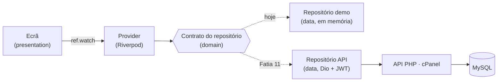

# Arquitetura — CubicoDesign3D Backoffice

Como a app está organizada, por onde passam os dados e onde fica cada coisa.
O âmbito, as decisões e o plano completo estão em [`cubico-backoffice.md`](cubico-backoffice.md).

**Última atualização:** 16/11/2026 — publicada no cPanel (API e web), Etsy ligada e a importar, clientes com telemóvel validado e localidade pelo código postal

---

## 1. Visão geral



Três regras resumem a arquitetura:

1. **Organizada por funcionalidade.** Tudo o que é de uma secção (encomendas, produtos…) vive na mesma pasta.
2. **Três camadas em cada funcionalidade**, e as dependências só vão num sentido: `presentation → domain ← data`.
3. **Os ecrãs nunca sabem de onde vêm os dados.** Pedem a um provider, que devolve um contrato. Trocar os dados demo pela API muda uma linha por repositório.

## 2. Pastas

```
cubico_backoffice/
├── app/                  app Flutter (Windows, Android, iOS)
│   ├── lib/
│   │   ├── main.dart     arranque: ProviderScope + App
│   │   ├── app/          o que é da app inteira
│   │   │   ├── app.dart          MaterialApp.router (tema + rotas)
│   │   │   ├── router.dart       todas as rotas
│   │   │   ├── theme.dart        cores, letras e estilos da marca
│   │   │   └── shell/app_shell.dart   menu lateral (PC) / menu de baixo (telemóvel)
│   │   └── features/     uma pasta por secção do menu
│   │       ├── dashboard/   orders/   production/   products/
│   │       └── customers/   costs/    settings/
│   └── test/             testes unitários, com a mesma árvore de lib/
├── api/                  API PHP 8 / Slim (Fase 3, ainda vazia)
├── database/             schema.sql (tabelas) e seed.sql (dados de arranque)
└── docs/                 documentação e ecrãs desenhados
```

## 3. As três camadas

| Camada | O que tem | Pode depender de |
|---|---|---|
| `domain/` | Modelos (Freezed), contratos dos repositórios, regras de negócio | nada da app (só Dart e Freezed) |
| `data/` | Implementações dos repositórios: `Demo…` agora, `Api…` na Fatia 11 | `domain` |
| `presentation/` | Ecrãs, widgets, providers e estado de ecrã | `domain` (e `data` só no provider que escolhe o repositório) |

**Onde fica cada tipo de código:**

- **Regras de negócio** (o que conta como atrasada, o passo seguinte de uma encomenda, o lucro) → getters no modelo, em `domain`. Exemplo: `Order.isOverdue`, `Order.nextStatus`, `Order.profit`.
- **Contas de custo** → `costs/domain/cost_calculator.dart`, Dart puro e testado.
- **Textos e cores para o ecrã** (o "Pendente" laranja, o "Pago" verde) → extensões em `presentation`. Exemplo: `orders/presentation/order_labels.dart`.

## 4. Funcionalidades feitas

```
features/
├── products/
│   ├── domain/        Product, ProductCategory, Variant (+ VariantFilament, VariantComponent)
│   │                  e os contratos ProductRepository, ProductCategoryRepository, VariantRepository
│   ├── data/          DemoProductRepository, DemoProductCategoryRepository, DemoVariantRepository
│   │                  (no demo, a foto fica num "data:" URI, sem servidor)
│   └── presentation/  products_screen      lista com filtro por categoria e miniatura da foto
│                      product_form_screen  criar / editar produto (duas colunas no PC), com a foto
│                      products_providers
│                      widgets/  category_dialog · cost_card · variants_section · product_photo
├── costs/
│   ├── domain/        Filament, Component, SalesChannel, Printer, CostSettings,
│   │                  CostCalculator e os contratos dos repositórios
│   ├── data/          Demo… de filamentos, componentes, canais, impressoras e definições
│   └── presentation/  costs_screen (6 separadores) e costs_providers
│                      tabs/  energy_tab · filaments_tab · components_tab · shipping_tab
│                             fees_tab · margins_tab
├── orders/
    ├── domain/        Order, OrderLine (com total, custo, lucro, atrasada, passo seguinte)
    ├── data/          DemoOrderRepository (datas relativas a hoje)
    └── presentation/  orders_screen        lista com separadores, pesquisa e filtro por canal
│                      order_detail_screen  detalhe com artigos, contas, cliente, envio e estados;
│                                           menu ⋮ "Cancelar encomenda" (pendente, em produção ou pronta)
│                      create_order_screen  criar encomenda manual, com resumo e lucro estimado;
│                                           no telemóvel, barra fixa em baixo com o total e "Criar"
│                      widgets/product_picker_dialog  escolher produto em 2 passos: produtos
│                                           (categoria, foto, procura) → variantes do produto tocado;
│                                           produto com uma só variante escolhe-se logo
│                      order_labels         textos e cores dos estados
│                      orders_providers
│                      widgets/  status_badge
├── production/
│   ├── domain/        PrintJob (com passo seguinte e progresso pelo tempo), o contrato
│   │                  e o ProductionService (as regras que ligam encomendas e produção)
│   ├── data/          DemoPrintJobRepository
│   └── presentation/  production_screen    quadro kanban com arrastar e a impressão em curso
│                      production_providers
├── dashboard/
│   └── presentation/  dashboard_screen     números do mês, encomendas por fazer e gráfico (fl_chart)
├── customers/
│   ├── domain/        Customer e Address (com a morada numa linha) e o contrato
│   ├── data/          DemoCustomerRepository
│   └── presentation/  customers_screen (lista com pesquisa e total gasto), customer_detail_screen
│                      (contactos, moradas, histórico) e customer_form_screen (criar e editar)
├── settings/
│   ├── data/          push_service (a ponte JS e as rotas /push)
│   └── presentation/  settings_screen (a minha conta, avisos, utilizadores, atalhos, sobre)
│                      widgets/  users_section, push_tile (ligar os avisos neste aparelho)
└── auth/
    ├── domain/        AppUser (com o papel, isAdmin e canSeeCosts), AuthRepository, AuthException
    │                  e UserRepository (gestão de utilizadores)
    ├── data/          DemoAuthRepository (contas de demonstração) e DemoUserRepository
    └── presentation/  login_screen e auth_providers (a sessão)
```

Todas as secções do menu têm o seu ecrã.

**Foto do produto:** uma por produto, **obrigatória ao criar** (os produtos antigos podem não ter; mostram um ícone). A app escolhe-a com o `file_picker` e reduz-a com `core/photos.dart` (`preparePhoto`: endireita pelo EXIF, 1600 px no lado maior, JPG) antes de enviar. Criar envia produto e foto juntos; trocar a foto é um pedido à parte. Não há "tirar a foto", só trocar.

**Serviços:** quando uma regra mexe em vários repositórios ao mesmo tempo (enviar uma encomenda para produção cria tarefas **e** muda a encomenda), fica num serviço em `domain`, que recebe os contratos dos repositórios. Exemplo: `ProductionService`. Com a API, estas regras passam para o servidor.

## 5. Estado: Riverpod ou `setState`?

| Situação | Ferramenta | Exemplo |
|---|---|---|
| Dados que vêm de um repositório | `FutureProvider` | `productsProvider`, `ordersProvider` |
| Dados de um item concreto | `FutureProvider.family` | `variantsProvider(productId)` |
| Um valor calculado a partir de outras placas | `Provider` | `printerCostPerHourProvider` (definições + impressora principal) |
| Uma escolha que tem de durar ao mudar de secção | `Notifier` | categoria escolhida, estado e pesquisa das encomendas |
| Estado que só interessa a um ecrã ou cartão | `setState` | campos do formulário, canal escolhido na calculadora |

Depois de gravar, o ecrã chama `ref.invalidate(...)` e a lista recarrega-se sozinha.

## 6. Sessão e papéis

- A sessão vive no `sessionProvider` (`AppUser?`): `null` = ninguém entrou.
- Dois papéis: **administrador** (vê tudo) e **colaborador** (só a parte operacional). Os ecrãs perguntam sempre `user.canSeeCosts`, e na dúvida escondem.
- O colaborador não vê: Custos e preços e Definições (nem no menu, nem pelo endereço), vendas e lucro no Dashboard, a coluna Lucro, o bloco de custos no detalhe, o custo e o lucro estimados ao criar encomenda, a calculadora e os custos dos produtos; e não cria, edita nem apaga produtos.
- **Esconder no Flutter não chega:** na Fase 3, a API deixa de enviar custos, lucros e margens a um colaborador.
- **"Manter sessão":** o token e o utilizador ficam no `SessionStorage` (`shared_preferences`; na web, o localStorage). O `main` recupera-os antes do primeiro ecrã e pergunta à API (`GET /auth/me`) o papel atual. Sem a caixa, nada fica guardado.
- **Sessão terminada pela API:** qualquer 401 (token expirado, acesso retirado, palavra-passe mudada noutro aparelho) chama o `TokenStore.onExpired`; a sessão apaga-se e o login mostra porquê, numa caixa âmbar (`loginMessageProvider`).
- **Mudar a palavra-passe:** nas Definições e no menu (o colaborador não abre as Definições). Escondido no modo demo.

## 7. Navegação

GoRouter com `StatefulShellRoute.indexedStack`: cada secção do menu é uma "gaveta" que guarda o seu estado. Um `redirect` (o "porteiro") manda para o login quem não tem sessão, e para o Dashboard o colaborador que tente abrir `/costs` ou `/settings`; o `refreshListenable` faz o porteiro decidir de novo sempre que a sessão muda.

| Caminho | Ecrã |
|---|---|
| `/login` | Entrar (fora da moldura, sem menu) |
| `/dashboard` | Dashboard (Início no telemóvel) |
| `/orders` · `/orders/new` · `/orders/:id` | Encomendas · criar encomenda · detalhe da encomenda |
| `/production` | Produção |
| `/products` · `/products/new` · `/products/:id` | Produtos · novo produto · editar produto |
| `/customers` · `/customers/new` · `/customers/:id` · `/customers/:id/edit` | Clientes · novo · ficha · editar |
| `/costs` | Custos e preços |
| `/settings` | Definições |

- **PC** (largura ≥ 900 px): menu lateral preto. Os ecrãs com muito conteúdo passam a duas colunas a partir de 1100 px.
- **Telemóvel:** menu de baixo com 4 secções (Início, Encomendas, Produção, Produtos).

## 8. Testes

Correm com `flutter test`, dentro de `app/`.

| Ficheiro | O que prova |
|---|---|
| `test/features/costs/cost_calculator_test.dart` | €/kg com portes, custo de filamento e de impressão, taxas por canal, margem, preço sugerido, custo de componentes, peso de envio, portes por zona e escalão |
| `test/features/orders/order_test.dart` | total, custo e lucro; canceladas contam 0; fluxo de estados |
| `test/features/production/print_job_test.dart` | progresso da impressão e minutos que faltam, calculados pelo tempo |
| `test/features/products/product_photo_test.dart` | a foto é reduzida a 1600 px (deitada e ao alto) e gravada em JPG, a pequena não cresce, um ficheiro que não é imagem é recusado; o repositório demo cria e troca a foto |

## 9. Convenções

- **Tudo o que é técnico em inglês** (código, ficheiros, pastas, tabelas, colunas); **a interface em português**.
- Material pelo pacote **`material_ui`**, nunca `package:flutter/material.dart`.
- Imports sempre com `package:cubico_backoffice/...`, nunca relativos.
- Texto entre **aspas** (`"Guardar"`); **plicas só nos imports**.
- Ficheiros em `snake_case`, classes em `PascalCase`, e os dois dizem o mesmo (`orders_screen.dart` → `OrdersScreen`).
- Ficheiros `*.freezed.dart` e `*.g.dart` são gerados: nunca se editam à mão (`dart run build_runner build`).
- Antes de cada commit: `flutter analyze` sem problemas e `flutter test` a passar.

## 10. A API (Fase 3)

PHP 8.3 + Slim 4 (o servidor tem 8.3; o `composer.json` fixa `platform.php`), em `api/`, e MariaDB 10.6 (o mesmo do alojamento cPanel).

```
api/
├── public/index.php   arranca a API e junta as rotas (o único ficheiro público)
├── src/               db (PDO, sempre utf8mb4) · helpers (json, fail, typed, token) · auth (os porteiros)
│                      tables (pedidos habituais de tabelas simples) · costs (as contas oficiais)
│                      photos (conferir e gravar as fotos dos produtos) · sku (os SKU automáticos)
│                      etsy (OAuth com PKCE, tokens cifrados, pedidos à Etsy) · etsy_sync (importar encomendas)
│                      etsy_listings (conferir os SKU dos anúncios) · push (avisos de encomendas novas)
├── routes/            um ficheiro por módulo: auth, categories, costs, products, customers,
│                      orders, production, users, etsy, health, push
├── storage/products/  as fotos dos produtos (fora de public/; nunca vão para o Git)
├── bin/create-user.php   criar utilizadores na linha de comandos
└── .env               segredos (base de dados, JWT); nunca vai para o Git — modelo em .env.example
```

- **Sessão:** `POST /api/auth/login` devolve um **JWT** (12 h; 30 dias com `remember`). Palavras-passe com `password_hash` (bcrypt). O Dio junta o token a cada pedido, num interceptor. O token leva `sub` e `pwv` (12 caracteres de um hash da palavra-passe guardada), não o papel.
- **`GET /api/auth/me`** devolve o utilizador atual; **`POST /api/auth/password`** muda a palavra-passe (mínimo 10 caracteres) e devolve um token novo. Como o `pwv` muda, os tokens dos outros aparelhos deixam de valer.
- **Porteiros:** `$requireAuth` (token válido, e confirma na base de dados que a conta existe, está ativa e tem a mesma palavra-passe; o papel vem daí, não do token) e `$requireAdmin` (papel admin). No Slim, o último `add` corre primeiro.
- **A API protege os dados:** o colaborador não recebe custos, taxas nem portes pagos; Custos e preços e Utilizadores são só do administrador.
- **Contas oficiais:** ao criar uma encomenda, a API refaz o custo de cada linha, as taxas e os portes (`src/costs.php`, as mesmas fórmulas da `CostCalculator`). Taxas (`channelLineFee` / `channelFees`): as % do canal sobre a linha e, na 1.ª linha, também sobre os portes cobrados; o fixo uma vez por encomenda; a listagem por unidade.
- **Tipos:** o PHP lê `DECIMAL` como texto e `BOOLEAN` como 0/1; o `typed()` converte antes de responder.
- **Segurança SQL:** os valores entram sempre por `?` (consultas preparadas).
- **Transações** onde se grava em várias tabelas (variante + receita, cliente + moradas, encomenda + linhas).
- **Fotos dos produtos:** `POST /api/products` é `multipart/form-data` (parte `product` com o JSON, parte `photo` com o ficheiro) e grava produto e foto numa transação; `POST /api/products/{id}/photo` troca-a. O tipo confirma-se pelo conteúdo (`finfo` + `getimagesize`): só JPG, PNG ou WebP, até 2 MB. O ficheiro fica em `storage/products/` com nome aleatório; `product_photos.url` guarda só esse nome, e a API responde com `photo_url` completo. `GET /api/photos/{ficheiro}` entrega a imagem, com CORS e sem sessão (o `Image.network` da web não envia o token). No servidor, a pasta `storage/products/` tem de existir com permissão de escrita.
- **Migrações:** alterações a bases de dados já existentes ficam em `database/migrations/` (001: portes por zona; 002: SKU automático; 003: ligação à Etsy; 004: importação da Etsy; 005: códigos postais; 006: cores disponíveis dos produtos; … 013: avisos push; 014: gramas com 2 casas decimais; 015: stock de filamento).
- **Gramas com 2 casas (migração 014):** `variant_filaments.grams`, `variants.grams_color_2` e `print_failures.wasted_grams` são `DECIMAL(8,2)`; a API arredonda a 2 (`round(…, 2)`), nunca corta para inteiro. Na app, `VariantFilament.grams` e `Variant.gramsColor2` são `double`; mostram-se com `gramsText()` ("86,4 g") e escrevem-se nos campos com `gramsField()` ("86,4"). `variants.weight_g` (portes) continua inteiro: o cartão de custo arredonda o total para cima (100,4 g → 101 g).
- **Etsy sozinha (tarefa agendada):** `bin/etsy-sync.php` faz o mesmo que "Sincronizar agora" e corre no cron do cPanel a cada 15 minutos. Só escreve quando há erro (o cPanel manda por email o que a tarefa escrever) e sai com 1; sem a loja ligada, ou com outra sincronização a meio (o mesmo `GET_LOCK` do botão), sai calado. Apaga os registos de `sync_runs` com mais de 30 dias. Está fora de `public/`, por isso o browser não lhe chega. Como corre a cada 15 minutos, o token de renovação da Etsy também se renova sozinho.
- **Cancelar:** o detalhe da encomenda grava `status = cancelled` pelo `PUT /api/orders/{id}` (administrador e colaborador; o Histórico guarda quem). As tarefas de impressão não se apagam: o `printJobsProvider` esconde as de encomendas canceladas que ainda não estão concluídas (as concluídas ficam, a peça foi impressa). Vale também para as canceladas na Etsy.
- **Paga → produção sozinha:** uma encomenda paga e "Pendente" passa a "Em produção" e cada artigo vira uma tarefa em "Por imprimir" (`autoStartProduction()` em `src/production.php`), sem esperar pelo botão. Corre ao criar uma encomenda manual, em cada `PUT /api/orders/{id}` e nas encomendas da Etsy (ao entrar e quando o pagamento chega). Se já houver tarefas, não cria outras; as por pagar continuam à espera do botão. No modo demo, a mesma regra está em `ProductionService.startIfPaid()`.
- **Códigos postais:** `GET /api/postal-codes/{4700-000}` (com sessão) devolve a localidade, o concelho e o distrito da tabela `postal_codes` (base dos CTT, uma linha por código; quando há várias localidades, fica a que tem mais ruas). Os dados não vão para o Git: geram-se a partir do `cp.db` da app do curso com `php -d extension=pdo_sqlite bin/postal-codes.php <cp.db> ../database/postal-codes.sql [--load]` e importam-se à parte. Na app, `PostalCodeRepository` (`Api…` / `Demo…`, este com uns poucos códigos); o formulário do cliente só preenche a localidade se estiver vazia ou se foi a app que a escreveu, e só em moradas de Portugal (as da Etsy podem ser de fora e guardam o país). O telemóvel valida-se em `contact_rules.dart` (português com ou sem +351, ou estrangeiro com + e 8 a 15 algarismos).
- **Etsy (fase 1, a ligação):** o administrador carrega em "Ligar à Etsy" nas Definições → `POST /api/etsy/connect` guarda um `state` e um `code_verifier` (PKCE, 10 minutos, uso único) e devolve o endereço da Etsy → a Etsy volta a `GET /api/etsy/callback` (sem sessão; protegido pelo `state`), que troca o código pelos tokens e descobre a loja. Os tokens ficam cifrados (AES-256-GCM, chave tirada do `JWT_SECRET`) na tabela `etsy_connection`; o de acesso renova-se sozinho (`etsyAccessToken()`). A chave da app (`ETSY_KEYSTRING`, `ETSY_SHARED_SECRET`, `ETSY_REDIRECT_URI`) vive no `.env`. O callback tem de ser `https`, por isso a ligação só se faz no servidor; no PC testa-se com uma Etsy falsa (`$GLOBALS['etsyHttpFake']`).
- **Etsy (fase 2, as encomendas):** "Sincronizar agora" (barra no topo das Encomendas) → `POST /api/etsy/sync` lê os recibos desde `etsy_import_from` (definição; por omissão, o dia da ligação), 100 por página. Cada recibo entra uma vez (`uq_source`). Os artigos digitais (`is_digital`) ignoram-se: uma encomenda só com digitais não entra (e não conta como "por associar"); numa encomenda mista entram só os físicos, com a parte proporcional do cupão. **Packs de quantidade:** uma variação chamada Quantidade/Quantity/Pack/Unidades com um número ("Quantidade: 10") multiplica as peças (`etsyPackFrom()`): a linha guarda as peças (custo, peso dos portes, tarefa e tempo de impressão certos), o preço por peça arredonda-se ao cêntimo para cima e a diferença vai para o desconto (o total fica o da Etsy); a taxa de anúncio conta as unidades da Etsy, não as peças. O "Conferir os SKU" mostra "pack de N peças". Os artigos ligam-se às variantes pelo SKU (ou, sem SKU, por `etsy_listing_id`); se faltar algum, a encomenda fica "por associar" e entra numa sincronização seguinte. Cliente pelo `etsy_buyer_user_id`; custo, taxas e portes reais com as mesmas contas das manuais (portes pela zona do país). Uma encomenda que já entrou só acompanha a Etsy em pago, enviado (com o seguimento) e cancelado/reembolsado, nunca para trás. Cada sincronização fica em `sync_runs`; `GET_LOCK` impede duas ao mesmo tempo.
- **Conferir os SKU:** `GET /api/etsy/listings-check` (administrador) lê os anúncios ativos da loja com o inventário (`includes=Inventory`, 100 por página) e passa cada produto pelo **mesmo** `etsyFindVariant()` da sincronização: `ok`, `unknown_sku` (SKU que nenhuma variante tem) ou `no_sku`. Os anúncios digitais (`listing_type = download`) não se conferem, só se contam (`digital_skipped`). Junta as variantes ativas que nenhum anúncio usa. Só lê. Precisa do scope `listings_r` (`ETSY_SCOPES = transactions_r shops_r listings_r`, tudo só leitura); uma ligação feita antes não o tem, a Etsy responde 403 e a API pede para "Ligar outra vez". Na app: botão "Conferir os SKU" na secção Etsy das Definições → `/settings/etsy-skus` (`EtsyListingsCheckScreen`), com os anúncios com problemas primeiro. O provider desliga o retry automático do Riverpod 3 (senão o erro ficava escondido atrás de "a carregar" e a Etsy levava 10 pedidos).
- **Avisos de encomendas novas (Web Push, migração 013):** cada aparelho que liga os avisos (Definições → Avisos, só administrador e só na web) fica em `push_subscriptions` (o `endpoint` do serviço de push, único pelo `endpoint_hash` SHA-256, e as chaves `p256dh`/`auth` do aparelho). Rotas (administrador): `GET /api/push/key` (a chave pública; 503 sem chaves), `POST`/`DELETE /api/push/subscriptions`, `POST /api/push/test`. `src/push.php` assina com VAPID (`VAPID_PUBLIC_KEY`, `VAPID_PRIVATE_KEY`, `VAPID_SUBJECT` no `.env`, gerados uma vez pelo `bin/vapid-setup.php`, que nunca as mostra) e envia com a biblioteca `minishlink/web-push`. `notifyNewOrders()` corre depois do commit de `POST /api/orders` (quem a criou não é avisado) e no fim da sincronização da Etsy; mais de 3 de uma vez dá um aviso só. Só administradores ativos recebem; o aviso nunca leva dinheiro; os aparelhos que o serviço diz que já não existem (404/410) apagam-se; um erro no envio nunca chega à encomenda (fica no log). Na web: `web/push_sw.js` (o service worker: mostra o aviso e, ao tocar, abre `/#/orders/<id>`), `web/push.js` (a ponte para a app, como o `passkeys.js`) e um `web/flutter_bootstrap.js` próprio, que arranca o Flutter **sem** o service worker do Flutter (esse apaga-se a si próprio e levaria o nosso). No iPhone/iPad só funciona com o site adicionado ao ecrã principal (iOS 16.4+). No PC (Windows), o PHP precisa de `OPENSSL_CONF=C:\php\extras\ssl\openssl.cnf` para criar chaves EC e de `-d curl.cainfo="C:\Program Files\Git\mingw64\etc\ssl\certs\ca-bundle.crt"` para enviar (sem isso: cURL error 60); o servidor não precisa de nada disto.
- **Stock de filamento (passo 2, migração 015):** o stock de um filamento é a soma (`SUM(grams)`) dos seus movimentos em `filament_movements` (`purchase`, `consumption`, `failure`, `adjustment`, `reversal`; positivo entra, negativo sai). Os movimentos nunca se editam nem se apagam: um engano corrige-se com um movimento novo. A migração acrescenta `filaments.empty_spool_g` (tara do carretel vazio; 0 = por saber) e apaga as tabelas antigas `spools` e `stock_movements`, que nunca se usaram (confirmar que estão vazias antes de a correr no servidor). Contas em `src/stock.php`: compras e acertos por pesagem (total = rolos fechados × `spool_weight_g` + Σ (bruto − `empty_spool_g`); o movimento é a diferença para o stock atual). Rotas em `routes/stock.php`: `GET /api/filaments/stock` e `GET /api/filaments/{id}/movements` (stock e histórico) para qualquer sessão, sem preços para o colaborador (nunca recebe `paid_price` nem `shipping_cost`); `POST /api/filaments/{id}/purchases` e `POST /api/filaments/{id}/adjustments` (compras e acertos) só administrador. O preço da compra é **por rolo** (como `filaments.paid_price`; tem de ser maior que zero); os portes são o total da encomenda (a calculadora divide-os pelos rolos); a compra passa preço, portes e rolos para o filamento e a app relê os filamentos. Na app, `features/stock/` (domain: `FilamentStock`, `FilamentMovement`, as contas de pesagem em `weighing.dart` (funções), contrato `StockRepository`; data: `Demo…` e `Api…`; presentation: `StockScreen` com a lista, `FilamentStockScreen` com o histórico, janelas de compra e de acerto), na rota `/stock` (ramo 7 do shell, no menu entre Produtos e Clientes). O campo "Carretel vazio" está em Custos e preços → Filamentos, com a oferta de copiar a tara para os filamentos da mesma marca. Provas: `php tests/stock-check.php` (contas, numa transação que acaba em rollback) e `php tests/stock-http-check.php` (rotas, com a API a correr; cria e apaga um utilizador temporário). Ainda não há consumo automático pela produção.
- **Na app:** cada placa de repositório escolhe o `Demo…` ou o `Api…` pelo `demoModeProvider`; o modo demo continua a funcionar sem servidor. Os erros da API chegam como `ApiException`, com a mensagem em português.

Para correr no PC: `php -S localhost:8080 -t public` dentro de `api` (ou o `iniciar-api.bat`), e a app com `flutter run -d windows`.

## 11. Estado das fatias

| Fatia | O quê | Estado |
|---:|---|:---:|
| 0 | Projeto, pacotes, tema, Git | ✅ |
| 1 | Esqueleto: menus e ecrãs vazios | ✅ |
| 2 | Modelos e dados demo | ✅ |
| 3 | Produtos e categorias | ✅ |
| 4 | Ficha do produto, calculadora de custo e variantes | ✅ |
| 5 | Custos e preços | ✅ |
| 6 | Encomendas: lista e detalhe | ✅ |
| 7 | Criar encomenda | ✅ |
| 8 | Produção (kanban) | ✅ |
| 9 | Dashboard com gráficos | ✅ |
| 10 | Login e papéis | ✅ |
| 11 | Ligar à API real | ✅ |
| 12 | Publicar no cPanel: API e versão web | ✅ |
| 13 | SKU automático e variantes por nome | ✅ |
| 14 | Etsy: ligar a loja e importar as encomendas | ✅ |
| 15 | Clientes: telemóvel e localidade pelo código postal | ✅ |
| 16 | Etsy: conferir os SKU dos anúncios contra as variantes | ✅ |
| 17 | Encomendas: cor de cada artigo (troca o filamento principal no custo) | ✅ |
| 18 | Produtos: ficha única com um só Guardar; cores disponíveis (migração 006) | ✅ |
| 19 | Produtos: cartão só com gramas e tempo; custo pela cor mais cara; cor obrigatória na encomenda | ✅ |
| 20 | Avisos de encomendas novas no telemóvel (Web Push, migração 013) | ✅ |
| 21 | Stock de filamento, passo 2: compras e acertos por pesagem (migração 015) | ✅ no PC; falta publicar |

**Limitações conhecidas:** um filamento por variante no cartão de custo (a cor mais cara das disponíveis); nas encomendas manuais, os portes reais usam só a zona Portugal; a produção ainda não desconta filamento do stock nem regista falhas; na API, "enviar para produção" à mão e "encomenda pronta sozinha" ainda correm na app, pelo ProductionService.

**Para fazer depois:** impressora Bambu Lab A1 (pela nuvem da Bambu, não oficial).

## 12. Publicação (alojamento cPanel)

| O quê | Onde | Endereço |
|---|---|---|
| API | `repositories/cubico_backoffice/api/public` | `https://api.fazendasubmersa.pt` |
| Versão web | `apps/backoffice-web` | `https://app.fazendasubmersa.pt` |
| Base de dados | MariaDB 10.6, a **verdadeira** da loja | — |

- **Sem terminal nem SSH.** O "Update from Remote" do Git Version Control falha, por isso os ficheiros vão pelo **File Manager**. A pasta `vendor` e o `.env` vão à mão (o `.env` nunca vai para o Git; modelo em `api/.env.example`).
- **PHP 8.3 no servidor** (o PC tem 8.4): o `composer.json` tem `config.platform.php = 8.3.0`.
- **Antes de publicar:** `flutter analyze`, `flutter test` e os testes da API contra a base do PC. Os testes nunca correm contra o servidor.
- **API:** guardar uma cópia dos ficheiros que vão mudar (`api-backup-<data>`), enviar os novos para as pastas certas (`src/`, `routes/`, `public/`) e confirmar que ficaram iguais aos do PC.
- **Web:** `flutter build web --dart-define=API_URL=https://api.fazendasubmersa.pt/api`; guardar uma cópia de `apps/backoffice-web`, enviar a build num zip e extrair por cima (o `canvaskit/` só muda quando muda o Flutter). Confirmar comparando o sha256 de cada ficheiro com o que o servidor devolve.
- **Migrações:** cópia de segurança da base antes de cada uma (phpMyAdmin → Exportar, ou a cópia do cPanel), correr a migração pelo phpMyAdmin e confirmar as colunas/tabelas no `information_schema`.
- **Códigos postais:** depois da migração 005, importar o `database/postal-codes.sql` (gerado no PC, cerca de 10 MB) pelo phpMyAdmin → Importar.
- **Tarefa agendada (cPanel → Cron Jobs), a cada 15 minutos (`*/15 * * * *`):** `/opt/alt/php83/usr/bin/php -d extension=mbstring.so /home/fazendas/repositories/cubico_backoffice/api/bin/etsy-sync.php`. A API usa o `alt-php83` (CloudLinux), cuja linha de comandos vem **sem mbstring**: daí o `-d extension=mbstring.so` (sem ele, o script avisa e não importa). Sem redirecionar a saída, para os erros chegarem por email.
- **Avisos push:** depois da migração 013 e de enviar o `vendor` novo, correr **uma vez** por tarefa agendada `/opt/alt/php83/usr/bin/php -d extension=mbstring.so /home/fazendas/repositories/cubico_backoffice/api/bin/vapid-setup.php` (junta as chaves ao `.env` se lá não estiverem) e apagar a tarefa. Na web vão também o `push.js`, o `push_sw.js` e o `flutter_bootstrap.js`.
- **Android:** a versão final (release) precisa da permissão `INTERNET` no `android/app/src/main/AndroidManifest.xml` (já lá está); as versões debug e profile têm-na à parte.
