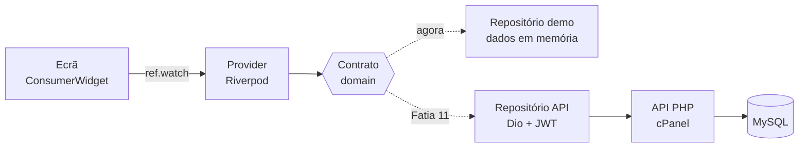

# Arquitetura — CubicoDesign3D Backoffice

Mapa da app: como está organizada, por onde passam os dados e em que ponto está cada parte.
Atualiza-se no fim de cada fatia. As decisões e o plano completo estão em [`cubico-backoffice.md`](cubico-backoffice.md).

**Última atualização:** 01/11/2026 — Fatia 3 em curso

---

## 1. O repositório

```
cubico_backoffice/
├── app/          → a app Flutter (Windows, Android, iOS)
├── api/          → a API em PHP 8 / Slim (Fase 3, ainda vazia)
├── database/     → schema.sql (tabelas) e seed.sql (dados de arranque)
└── docs/         → documentação e ecrãs desenhados
```

## 2. A app por dentro (`app/lib/`)

A app está organizada **por funcionalidade** (*feature-first*): tudo o que é de uma secção vive na mesma pasta.

```
lib/
├── main.dart                 → arranca a app (ProviderScope + App)
├── app/                      → o que é da app inteira
│   ├── app.dart              → MaterialApp.router: junta tema e rotas
│   ├── router.dart           → as rotas (GoRouter) e as 7 secções do menu
│   ├── theme.dart            → cores, letras e estilos da marca
│   └── shell/
│       └── app_shell.dart    → a "moldura": menu lateral (PC) ou menu de baixo (telemóvel)
├── core/                     → partilhado entre funcionalidades (ainda vazio)
└── features/
    ├── dashboard/            → Início / Dashboard
    ├── orders/               → Encomendas
    ├── production/           → Produção
    ├── products/             → Produtos e categorias
    ├── customers/            → Clientes
    ├── costs/                → Custos e preços (filamentos, energia, portes…)
    └── settings/             → Definições
```

### As três camadas de cada funcionalidade

Cada pasta em `features/` divide-se em até três partes:

| Pasta | O que tem | Analogia |
|---|---|---|
| `domain/` | Os **modelos** (Freezed) e os **contratos** dos repositórios | A lista do que se pode pedir ao balcão |
| `data/` | Os **repositórios**: quem vai buscar os dados (demo em memória agora, API depois) | Quem está ao balcão a atender |
| `presentation/` | Os **ecrãs**, os widgets e os **providers** do Riverpod | A placa na parede que diz onde está o balcão, e o cliente que pede |

Regra: `presentation` nunca fala diretamente com `data`. Pede sempre através de um provider, que devolve o **contrato** do `domain`.

Exemplo real, nos produtos:

```
features/products/
├── domain/
│   ├── product.dart, variant.dart, product_category.dart   → modelos Freezed
│   ├── product_category_repository.dart                    → contrato
│   └── product_repository.dart                             → contrato
├── data/
│   ├── demo_product_category_repository.dart               → dados demo em memória
│   └── demo_product_repository.dart
└── presentation/
    ├── products_providers.dart                             → providers do Riverpod
    ├── products_screen.dart                                → ecrã
    └── widgets/
        └── category_dialog.dart                            → janela de criar/editar categoria
```

Os ficheiros `*.freezed.dart` e `*.g.dart` são **gerados** pelo `build_runner` a partir dos modelos. Nunca se editam à mão: se um modelo mudar, corre-se `dart run build_runner build`.

## 3. O caminho dos dados



1. O **ecrã** pede os dados com `ref.watch(provider)` e recebe um `AsyncValue`: *a carregar*, *com dados* ou *com erro*.
2. O **provider** pede ao **repositório**, conhecendo só o contrato.
3. Hoje responde o **repositório demo**. Na Fatia 11, troca-se só a linha do provider para o **repositório da API**, e os ecrãs não mudam.
4. A **API** é a única que conhece a base de dados e as credenciais, e é ela que faz as contas (custos, lucros, totais).

## 4. Navegação

- **GoRouter** com `StatefulShellRoute.indexedStack`: cada secção do menu é uma "gaveta" que guarda o seu estado.
- **PC** (largura ≥ 900 px): menu lateral preto, com logótipo, 7 secções e utilizador no fundo.
- **Telemóvel**: menu de baixo com 4 secções (Início, Encomendas, Produção, Produtos).

| Gaveta | Caminho | Secção |
|---:|---|---|
| 0 | `/dashboard` | Dashboard (Início no telemóvel) |
| 1 | `/orders` | Encomendas |
| 2 | `/production` | Produção |
| 3 | `/products` | Produtos |
| 4 | `/customers` | Clientes |
| 5 | `/costs` | Custos e preços |
| 6 | `/settings` | Definições |

## 5. Mapa das funcionalidades

✅ feito · ⏳ em curso · ⬜ por fazer

| Fatia | O quê | Estado |
|---:|---|:---:|
| 0 | Projeto, pacotes, tema, Git | ✅ |
| 1 | Esqueleto: menus e ecrãs vazios | ✅ |
| 2 | Modelos e dados demo | ✅ modelos; dados demo de categorias e produtos |
| 3 | Produtos e categorias (criar, editar, apagar, filtrar) | ⏳ categorias completas; lista de produtos com filtro |
| 4 | Ficha do produto + calculadora de custo | ⬜ |
| 5 | Custos e preços | ⬜ |
| 6 | Encomendas: lista e detalhe | ⬜ |
| 7 | Criar encomenda | ⬜ |
| 8 | Produção (kanban) | ⬜ |
| 9 | Dashboard com gráficos | ⬜ |
| 10 | Login e papéis | ⬜ |
| 11 | Ligar à API real | ⬜ |

## 6. Convenções

- **Tudo o que é técnico em inglês** (código, ficheiros, pastas, tabelas, colunas); **a interface em português**.
- Material pelo pacote **`material_ui`** (`import 'package:material_ui/material_ui.dart';`), nunca `package:flutter/material.dart`.
- Nomes de ficheiros em `snake_case`, nomes de classes em `PascalCase`, e os dois dizem o mesmo (`products_screen.dart` → `ProductsScreen`).
- Antes de cada commit: `flutter analyze` sem problemas.
