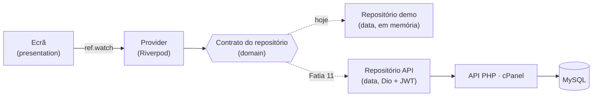

# Arquitetura — CubicoDesign3D Backoffice

Como a app está organizada, por onde passam os dados e onde fica cada coisa.
O âmbito, as decisões e o plano completo estão em [`cubico-backoffice.md`](cubico-backoffice.md).

**Última atualização:** 06/11/2026 — Fatias 0 a 6 concluídas (portes de envio pendentes)

---

## 1. Visão geral



Três regras resumem a arquitetura:

1. **Organizada por funcionalidade.** Tudo o que é de uma secção (encomendas, produtos…) vive na mesma pasta.
2. **Três camadas em cada funcionalidade**, e as dependências só vão num sentido: `presentation → domain ← data`.
3. **Os ecrãs nunca sabem de onde vêm os dados.** Pedem a um provider, que devolve um contrato. Trocar os dados demo pela API muda uma linha por repositório.

## 2. Pastas

```
cubico_backoffice/
├── app/                  app Flutter (Windows, Android, iOS)
│   ├── lib/
│   │   ├── main.dart     arranque: ProviderScope + App
│   │   ├── app/          o que é da app inteira
│   │   │   ├── app.dart          MaterialApp.router (tema + rotas)
│   │   │   ├── router.dart       todas as rotas
│   │   │   ├── theme.dart        cores, letras e estilos da marca
│   │   │   └── shell/app_shell.dart   menu lateral (PC) / menu de baixo (telemóvel)
│   │   └── features/     uma pasta por secção do menu
│   │       ├── dashboard/   orders/   production/   products/
│   │       └── customers/   costs/    settings/
│   └── test/             testes unitários, com a mesma árvore de lib/
├── api/                  API PHP 8 / Slim (Fase 3, ainda vazia)
├── database/             schema.sql (tabelas) e seed.sql (dados de arranque)
└── docs/                 documentação e ecrãs desenhados
```

## 3. As três camadas

| Camada | O que tem | Pode depender de |
|---|---|---|
| `domain/` | Modelos (Freezed), contratos dos repositórios, regras de negócio | nada da app (só Dart e Freezed) |
| `data/` | Implementações dos repositórios: `Demo…` agora, `Api…` na Fatia 11 | `domain` |
| `presentation/` | Ecrãs, widgets, providers e estado de ecrã | `domain` (e `data` só no provider que escolhe o repositório) |

**Onde fica cada tipo de código:**

- **Regras de negócio** (o que conta como atrasada, o passo seguinte de uma encomenda, o lucro) → getters no modelo, em `domain`. Exemplo: `Order.isOverdue`, `Order.nextStatus`, `Order.profit`.
- **Contas de custo** → `costs/domain/cost_calculator.dart`, Dart puro e testado.
- **Textos e cores para o ecrã** (o "Pendente" laranja, o "Pago" verde) → extensões em `presentation`. Exemplo: `orders/presentation/order_labels.dart`.

## 4. Funcionalidades feitas

```
features/
├── products/
│   ├── domain/        Product, ProductCategory, Variant (+ VariantFilament, VariantComponent)
│   │                  e os contratos ProductRepository, ProductCategoryRepository, VariantRepository
│   ├── data/          DemoProductRepository, DemoProductCategoryRepository, DemoVariantRepository
│   └── presentation/  products_screen      lista com filtro por categoria
│                      product_form_screen  criar / editar produto (duas colunas no PC)
│                      products_providers
│                      widgets/  category_dialog · cost_card · variants_section
├── costs/
│   ├── domain/        Filament, Component, SalesChannel, Printer, CostSettings,
│   │                  CostCalculator e os contratos dos repositórios
│   ├── data/          Demo… de filamentos, componentes, canais, impressoras e definições
│   └── presentation/  costs_screen (6 separadores) e costs_providers
│                      tabs/  energy_tab · filaments_tab · components_tab · fees_tab · margins_tab
└── orders/
    ├── domain/        Order, OrderLine (com total, custo, lucro, atrasada, passo seguinte)
    ├── data/          DemoOrderRepository (datas relativas a hoje)
    └── presentation/  orders_screen        lista com separadores, pesquisa e filtro por canal
                       order_detail_screen  detalhe com artigos, contas, cliente, envio e estados
                       order_labels         textos e cores dos estados
                       orders_providers
                       widgets/  status_badge
```

As restantes secções (`dashboard`, `production`, `customers`, `settings`) têm, por agora, só o ecrã vazio.

## 5. Estado: Riverpod ou `setState`?

| Situação | Ferramenta | Exemplo |
|---|---|---|
| Dados que vêm de um repositório | `FutureProvider` | `productsProvider`, `ordersProvider` |
| Dados de um item concreto | `FutureProvider.family` | `variantsProvider(productId)` |
| Um valor calculado a partir de outras placas | `Provider` | `printerCostPerHourProvider` (definições + impressora principal) |
| Uma escolha que tem de durar ao mudar de secção | `Notifier` | categoria escolhida, estado e pesquisa das encomendas |
| Estado que só interessa a um ecrã ou cartão | `setState` | campos do formulário, canal escolhido na calculadora |

Depois de gravar, o ecrã chama `ref.invalidate(...)` e a lista recarrega-se sozinha.

## 6. Navegação

GoRouter com `StatefulShellRoute.indexedStack`: cada secção do menu é uma "gaveta" que guarda o seu estado.

| Caminho | Ecrã |
|---|---|
| `/dashboard` | Dashboard (Início no telemóvel) |
| `/orders` · `/orders/:id` | Encomendas · detalhe da encomenda |
| `/production` | Produção |
| `/products` · `/products/new` · `/products/:id` | Produtos · novo produto · editar produto |
| `/customers` | Clientes |
| `/costs` | Custos e preços |
| `/settings` | Definições |

- **PC** (largura ≥ 900 px): menu lateral preto. Os ecrãs com muito conteúdo passam a duas colunas a partir de 1100 px.
- **Telemóvel:** menu de baixo com 4 secções (Início, Encomendas, Produção, Produtos).

## 7. Testes

Correm com `flutter test`, dentro de `app/`.

| Ficheiro | O que prova |
|---|---|
| `test/features/costs/cost_calculator_test.dart` | €/kg com portes, custo de filamento e de impressão, taxas por canal, margem, preço sugerido, custo de componentes |
| `test/features/orders/order_test.dart` | total, custo e lucro; canceladas contam 0; fluxo de estados |

## 8. Convenções

- **Tudo o que é técnico em inglês** (código, ficheiros, pastas, tabelas, colunas); **a interface em português**.
- Material pelo pacote **`material_ui`**, nunca `package:flutter/material.dart`.
- Imports sempre com `package:cubico_backoffice/...`, nunca relativos.
- Texto entre **aspas** (`"Guardar"`); **plicas só nos imports**.
- Ficheiros em `snake_case`, classes em `PascalCase`, e os dois dizem o mesmo (`orders_screen.dart` → `OrdersScreen`).
- Ficheiros `*.freezed.dart` e `*.g.dart` são gerados: nunca se editam à mão (`dart run build_runner build`).
- Antes de cada commit: `flutter analyze` sem problemas e `flutter test` a passar.

## 9. Estado das fatias

| Fatia | O quê | Estado |
|---:|---|:---:|
| 0 | Projeto, pacotes, tema, Git | ✅ |
| 1 | Esqueleto: menus e ecrãs vazios | ✅ |
| 2 | Modelos e dados demo | ✅ |
| 3 | Produtos e categorias | ✅ |
| 4 | Ficha do produto, calculadora de custo e variantes | ✅ |
| 5 | Custos e preços | ✅ (portes de envio pendentes) |
| 6 | Encomendas: lista e detalhe | ✅ |
| 7 | Criar encomenda | ⬜ |
| 8 | Produção (kanban) | ⬜ |
| 9 | Dashboard com gráficos | ⬜ |
| 10 | Login e papéis | ⬜ |
| 11 | Ligar à API real | ⬜ |

**Limitações conhecidas:** um filamento por variante no cartão de custo; ainda não se criam nem apagam variantes; portes de envio por preencher (à espera da tabela dos CTT).
