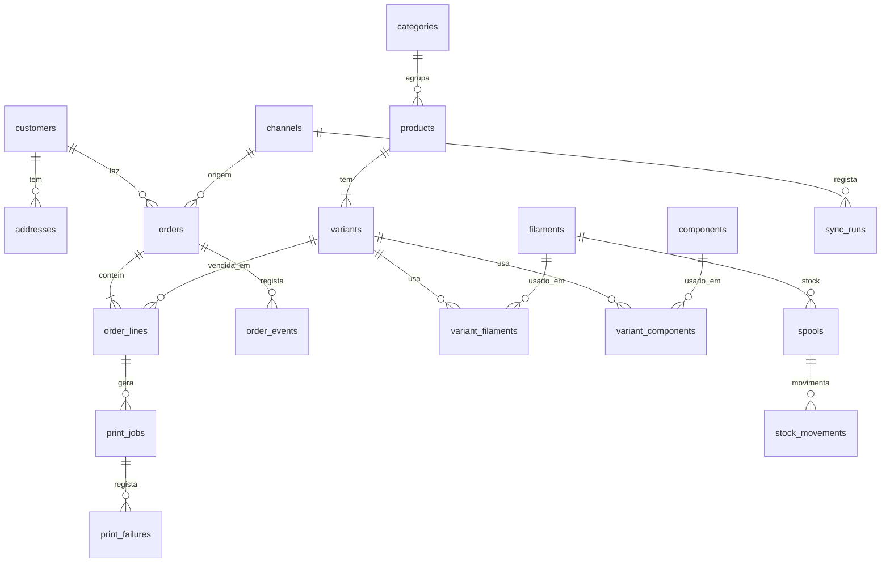

# CubicoDesign3D Backoffice — Documento do projeto

> Projeto principal do portfólio Flutter.
> Estado: **Fase 1 concluída · Fase 2 em validação**

| Fase | Tema | Estado |
|------|------|--------|
| 1 | Âmbito, arquitetura e ecrãs | ✅ Concluída |
| 2 | Esquema da base de dados | 🔍 Em validação |
| 3 | API em PHP | ⏳ |
| 4 | App Flutter em **modo demo**, por fatias (ver plano no fim) | ▶️ A começar |
| 5 | Módulos da v1, um a um | ⏳ |

## Resumo rápido (ler primeiro)

- **Ecrãs:** canvas com todos os ecrãs desenhados → https://claude.ai/artifact/7tKJPB8zAAbLTaaAYmsU61 · imagens JPG no projeto (pasta `ecras`).
- **Validados (9):** Login, Dashboard, Lista de encomendas, Detalhe da encomenda, Criar encomenda, Produtos e categorias, Produto e custos, Custos e preços, Produção.
- **Por desenhar:** Clientes; Definições (com gestão de utilizadores); versões do colaborador (sobretudo o dashboard operacional); Produção e Produtos no telemóvel.
- **Decisões em aberto:** estados das encomendas e da produção estão completos?; falta algum campo nas encomendas (embrulho, nota ao cliente…)?; versão do MySQL/MariaDB no cPanel; preço de compra real da Bambu Lab A1 (para o desgaste).
- **Decisões-chave:** Etsy entra sozinha; Instagram, Facebook e Pessoalmente registam-se em "Criar encomenda" (sem ficha de cliente obrigatória); dois papéis (administrador e colaborador — o colaborador nunca vê custos, lucros nem margens, mas pode alterar preços, ficando registado); API em PHP no cPanel; **app nativa Windows + Android + iOS, sem versão web** (decidido a 2026-10-26; substitui "Flutter web + iPhone pelo Safari"); luz a 0,21 €/kWh, A1 a 95 W; filamentos com preço normal e preço pago.
- **Decisões técnicas:** **tudo em inglês — código Dart e base de dados** (classes, variáveis, ficheiros, pastas, tabelas, colunas); **só a interface em português**. Decidido a 2026-10-28; substitui "BD em português com `@JsonKey`". Os nomes batem certo dos dois lados, por isso não é preciso `@JsonKey` — e deixa de haver o erro mudo de escrever o nome com gralha no `@JsonKey`, que compila e devolve `null`; Material pelo pacote `material_ui` em vez de `package:flutter/material.dart`, com Flutter 3.47+.
- **Forma de trabalhar:** o Rui escreve o código; o Claude explica, revê e ajuda. Plano por fatias no fim deste documento.

---

# FASE 1 — Âmbito, arquitetura e ecrãs

## 1. Visão geral

Backoffice para gerir toda a operação da CubicoDesign3D: catálogo, produção, encomendas, clientes, custos e resultados.

**Princípio central:** as encomendas da **Etsy entram sozinhas** — o dono da loja não as introduz, só as trata. As vendas feitas **pessoalmente, pelo Instagram ou pelo Facebook** são registadas no backoffice com "Criar encomenda", pelo dono ou por quem o ajuda na loja.

## 2. Marca

- Logotipo a preto e branco: ícone de impressora sobre cubo + "CubicoDesign3D" + slogan "transformamos ideias em volume".
- Versões preparadas (fundo transparente): `logo-branco.png`, `icone-branco.png`, `icone-preto.png` → vão para `app/assets/brand/`.
- Tipografia: **Poppins** (nome da marca e títulos de destaque), **Manrope** (interface), **JetBrains Mono** (valores, nº de encomenda, SKU).
- Cores: preto `#18181B` (menu), fundo `#F4F3EF`, destaque laranja `#C2410C` (provisório até haver cor oficial da marca).

## 3. Arquitetura

```
┌──────────────────────────────┐
│  Backoffice Flutter          │  Windows (PC) + Android + iOS — sem web
│  Riverpod · GoRouter         │
│  Dio · Freezed · fl_chart    │
└──────────────┬───────────────┘
               │ HTTPS / JSON (REST) + JWT
┌──────────────▼───────────────┐
│  API em PHP 8 (Slim)         │  regras de negócio, cálculos,
│  no cPanel                   │  sincronização (cron jobs)
└──────────────┬───────────────┘
               │
┌──────────────▼───────────────┐
│  MySQL / MariaDB (cPanel)    │
└──────────────────────────────┘
```

**Decisão:** o alojamento é partilhado (cPanel, só PHP). Por isso a API é em **PHP 8 com Slim** em vez de Dart. O cPanel aloja **só a API**: a app é nativa (Windows, Android, iOS) e não há versão web, por decisão de 2026-10-26.

Regras:
- A app **nunca** liga diretamente ao MySQL; só a API conhece as credenciais.
- **A API faz as contas e as regras; o Flutter só mostra e envia ações.**
- **Modo demo**: repositórios com dados de exemplo locais, para a demo pública do portfólio.

Estrutura do repositório:

```
cubico_backoffice/
├── app/      # Flutter (feature-first)
├── api/      # PHP 8 + Slim
├── database/ # schema.sql, dados de exemplo
└── docs/     # este documento
```

## 4. De onde vêm as encomendas

| Canal | Como entra | Automático |
|-------|-----------|-----------|
| Etsy | API da Etsy (app de uso pessoal). Cron job no cPanel lê as encomendas de x em x minutos | ✅ |
| Loja online própria (v3) | Cada compra cria a encomenda diretamente na BD | ✅ |
| Instagram | "Criar encomenda" no backoffice, pelo dono ou por quem ajuda na loja | ✍️ |
| Facebook | "Criar encomenda" no backoffice | ✍️ |
| Pessoalmente (boca a boca, feiras, eventos) | "Criar encomenda" no backoffice, só com nome/referência (sem ficha de cliente) | ✍️ |

**Canais de venda:** Etsy (automático), Instagram, Facebook e Pessoalmente. A criação de encomendas no backoffice só mostra **Pessoalmente, Instagram e Facebook** — a Etsy nunca aparece lá, porque já está ligada. Loja online própria fica para a v3.

- A sincronização é **idempotente**: a mesma encomenda Etsy nunca entra duas vezes (chave única canal + referência externa).
- No ecrã aparece o estado da sincronização ("Etsy há 5 min · Loja há 2 min") e um botão "Sincronizar agora".

## 5. Módulos

### 5.1 Autenticação
- Login com email e palavra-passe (JWT emitido pela API). "Manter sessão". Botão "Explorar em modo demo".

### 5.1b Utilizadores e permissões

Dois papéis. **Quem ajuda na loja vê só a parte operacional — nunca custos, lucros nem margens.**

| Área | Administrador | Colaborador |
|------|:---:|:---:|
| Dashboard | Completo (vendas, lucro, margens) | **Operacional**: encomendas pendentes e atrasadas, fila de produção, alertas de filamento |
| Lista de encomendas | Tudo | Sem coluna Lucro (vê o Total, para saber quanto cobrar) |
| Detalhe da encomenda | Tudo | Sem o bloco Custos/Lucro; vê o que foi recebido |
| Criar encomenda | Botão discreto | **Botão principal**; resumo sem custo nem lucro estimados |
| Alterar o preço de um artigo (descontos) | ✅ | ✅ — fica registado no histórico e a encomenda aparece ao administrador com a marca "Preço alterado" |
| Mudar estados, envio, seguimento | ✅ | ✅ |
| Produção (kanban, falhas) | ✅ | ✅ |
| Produtos e categorias | Criar, editar, apagar | Só consultar: fotos, variantes, preço de venda (sem custo, margem nem calculadora) |
| Clientes | ✅ | Consultar |
| Custos e preços, Relatórios, Definições | ✅ | ❌ não aparecem no menu |
| Gestão de utilizadores | ✅ | ❌ |

Regras:
- **A API é que protege os dados**, não só os ecrãs: para um colaborador, a API nunca envia `custo_unit`, `taxa_canal`, `portes_pagos`, lucro nem margem. Esconder no Flutter não chega.
- Cada encomenda guarda **quem a criou**; cada mudança fica no histórico com o nome da pessoa.
- O administrador pode **desativar** uma conta sem a apagar (o histórico mantém o nome).

### 5.2 Dashboard
- Vendas, lucro, nº de encomendas e margem média do período, com comparação ao período anterior.
- Gráfico de vendas e lucro, vendas por canal, mais vendidos.
- Alertas: encomendas atrasadas, filamento com stock baixo, tarefas na fila.

### 5.3 Encomendas
- Lista com filtros por estado, canal, pagamento e período; destaque às atrasadas; paginação; exportar CSV.
- Detalhe: progresso, artigos e personalização, recebido vs. custos → **lucro real**, cliente, envio e código de seguimento, pagamento, notas internas, histórico.
- Estados:

```
Pendente → Em produção → Pronta → Enviada → Entregue
    └─────────────→ Cancelada
```

- **Criar encomenda**, em 5 passos: Origem (**Pessoalmente, Instagram ou Facebook**) → **Para quem?** (só um nome ou referência e contacto opcional — **não cria ficha de cliente**; pode, se quiseres, associar a um cliente existente) → Artigos (variante, qtd., preço editável, personalização) → Entrega (em mão, levantamento, CTT com morada e portes) → Pagamento e notas. Resumo com total, custo e lucro estimados.

### 5.4 Produtos
- **Lista de produtos com painel de Categorias** à esquerda: cada categoria mostra quantos produtos tem; tocar numa categoria filtra a lista.
- **Criar categoria:** campo "Nova categoria" + "Adicionar" no fundo do painel (a categoria recebe uma cor automática). **Editar e apagar:** o lápis ao lado de cada categoria abre a edição no próprio sítio — mudar o nome, escolher a cor e Guardar/Cancelar. "Apagar categoria" pede confirmação e **só aparece se a categoria não tiver produtos**; se tiver, a app diz quantos tem e pede para os mudar de categoria primeiro. Renomear atualiza logo todos os produtos dessa categoria. Arrastar para mudar a ordem.
- **Atribuir a um produto:** na ficha do produto, o campo Categoria é uma lista com as categorias existentes e a opção "+ Nova categoria…", para criar uma sem sair do produto.
- Cada produto tem **uma** categoria.
- Ficha: nome, SKU, categoria, descrição, fotos, estado (ativo / rascunho / arquivado).
- Variantes com SKU, preço, filamentos (tipo + gramas), tempo de impressão, nº de tabuleiros, ficheiro .3mf.
- Componentes e embalagem; packs (v2).
- **Calculadora de custo e margem ligada a Custos e preços** (nada é escrito à mão):
  - **Filamento** escolhido da lista (com o €/kg do preço pago) × gramas.
  - **Impressão**: horas × custo/h da impressora (luz + desgaste).
  - **Componentes** com **quantidade por unidade** (botões − e +; ex.: 4 ímanes no CubicoDesk), cada um com o seu custo e peso.
  - **Embalagem**: escolhida da lista (tocar para incluir), com o seu custo e peso.
  - **Canal**: taxas da Etsy, ou nenhuma para Instagram, Facebook e Pessoalmente.
  - **Preço de venda** com margem em tempo real (aviso abaixo da margem mínima) e **preço sugerido** pela margem alvo, já arredondado.
  - **Envio estimado**: peso da peça + embalagem → escalão e preço dos portes.
- Na tabela de variantes, o **custo de produção** de cada variante (filamento + impressão + componentes + embalagem, sem taxas nem portes).

### 5.5 Produção — como funciona

1. "Enviar para produção" numa encomenda → a API cria **tarefas de impressão** (uma por linha), com filamento e tempo vindos da ficha do produto.
2. Quadro kanban: **Por imprimir → A imprimir → Pós-processamento → Concluído**. Arrastar um cartão = pedido à API a mudar o estado da tarefa.
3. Ao concluir uma tarefa, a API **desconta as gramas** do stock de filamento.
4. Quando **todas** as tarefas de uma encomenda estão concluídas → a encomenda passa **sozinha** a "Pronta".
5. Falhas de impressão registam gramas e tempo perdidos, que entram nos custos.
6. Painel "Filamento necessário" compara o que a fila precisa com o stock.

**Progresso da impressora (v1):** botão "Iniciar impressão" e progresso calculado pelo tempo estimado. A ligação real à Bambu Lab A1 fica para mais tarde (a impressora comunica pela rede de casa, o cPanel está na internet).

### 5.6 Dashboard — como os gráficos ficam ligados no Flutter

O Flutter **não soma nada**. A API faz as contas no MySQL (`SUM`, `GROUP BY`) e devolve tudo num pedido:

```
GET /dashboard?periodo=mes
```

```json
{
  "vendas": 412.0, "lucro": 238.4, "encomendas": 27, "margem_media": 58,
  "comparacao": { "vendas": 18, "lucro": 22, "encomendas": -4 },
  "serie": [{ "dia": "2026-10-01", "vendas": 12.0, "lucro": 6.5 }],
  "canais": [{ "canal": "etsy", "total": 206.0 }],
  "top_produtos": [{ "nome": "Pack marinho flexi", "quantidade": 24 }],
  "alertas": { "atrasadas": 2, "stock_baixo": ["PLA preto mate"], "fila": 6 }
}
```

Caminho no Flutter:
- **Dio** faz o pedido → **Freezed** converte em `DashboardResumo` → **Riverpod** guarda num provider que depende do período → os widgets só desenham (**fl_chart** para os gráficos).

```dart
final dashboardProvider = FutureProvider.family<DashboardResumo, Periodo>(
  (ref, periodo) => ref.watch(dashboardRepoProvider).obter(periodo),
);

LineChartBarData(
  spots: [for (var i = 0; i < resumo.serie.length; i++)
    FlSpot(i.toDouble(), resumo.serie[i].vendas)],
)
```

Mudar o período → o provider volta a pedir sozinho. No modo demo, o repositório devolve dados de exemplo e o resto da app não dá pela diferença.

### 5.6b Custos e preços — onde ficam todos os custos

Ecrã único com 6 separadores. **Defines uma vez e a app usa estes valores em todos os cálculos** (calculadora do produto, custo de cada encomenda, lucro, preço sugerido). Alterar um valor **não mexe** no lucro de encomendas já feitas.

| Separador | O que defines | Como a app usa |
|-----------|---------------|----------------|
| **Energia e impressoras** | Preço do kWh do contrato; por impressora: consumo médio (W), preço de compra, vida útil (h), manutenção por ano, horas de impressão por ano | Calcula o **custo por hora** de impressão (eletricidade + desgaste) — com os valores reais: 95 W (média oficial da A1 em PLA) × 0,21 €/kWh (contrato, com IVA) ≈ 0,020 €/h de luz + 350 €/5000 h + 40 €/1500 h de desgaste ≈ **0,12 €/h** |
| **Filamentos** | Tipo, marca, cor, peso do rolo, **preço normal** e **preço pago** (com desconto/promoção), portes da compra | Calcula o **€/kg** com o preço pago; o normal fica como referência e mostra a poupança. **Adicionar e editar** num formulário próprio (tipo, marca, cor e amostra, peso do rolo, preço normal, preço pago, portes da compra e nº de rolos nessa compra), com pré-visualização do custo real |
| **Embalagens e componentes** | **Componentes** (vão dentro do produto: argolas, ímanes, parafusos, mosquetões…) e **embalagens** (sacos por tamanho, caixas, envelopes, papel, cartões, autocolantes). Botões "+ Componente" e "+ Embalagem" abrem um formulário: nome, tamanho, preço do pack, unidades no pack, peso por unidade; lápis para editar; filtro Todos/Componentes/Embalagens | Calcula o **custo por unidade**; em cada produto escolhes quais usa; o peso entra no escalão dos portes |
| **Portes de envio** | Por transportadora: zonas (Portugal Continental, Açores e Madeira, Europa, Resto do mundo) × escalões de peso | Calcula **quanto te custa enviar** cada encomenda pelo peso total e pela zona da morada |
| **Taxas** | Etsy (transação, processamento, fixo, listagem); Instagram, Facebook e Pessoalmente sem taxa; métodos de pagamento | Entra no custo de cada venda |
| **Margens e custos fixos** | Margem alvo e mínima, arredondamento de preços, valor da tua hora (opcional), custos fixos mensais (alojamento, Etsy Plus…) | Preço sugerido, aviso de margem baixa, e opção de repartir os custos fixos pelas encomendas |

Os valores mostrados nos ecrãs são **de exemplo**; os reais copiam-se da fatura da luz, das tabelas da transportadora e da conta Etsy.

**Custo completo de uma unidade:**

```
filamento   = Σ gramas × €/kg ÷ 1000
impressão   = horas × €/h da impressora (luz + desgaste)
embalagem   = Σ custo/un. dos componentes e embalagens
taxas       = preço × (% transação + % processamento) + fixo + listagem
mão de obra = minutos de pós-processamento × valor da hora (opcional)
```

**Por encomenda** soma-se ainda o envio real (tabela de portes) e, se ativado, a parte dos custos fixos.

### 5.7 Clientes
- Ficha com contactos, Instagram, moradas, histórico, total gasto, notas.

### 5.8 Stock (v2)
- Rolos de filamento com peso restante; desconto automático; alerta de mínimo. Componentes e embalagens.

### 5.9 Relatórios (v2)
- Vendas, lucro e custos por período, canal, produto e categoria; exportar CSV.

### 5.10 Definições
- Marca, canais e taxas, custos de energia e desgaste, transportadoras, categorias, utilizador.

## 6. Ecrãs desenhados (canvas "CubicoDesign3D Backoffice — Ecrãs")

| Ecrã | Plataforma | Estado |
|------|-----------|--------|
| Dashboard | Desktop + telemóvel | ✅ Aprovado (para já) |
| Lista de encomendas | Desktop + telemóvel | ✅ Aprovado |
| Detalhe da encomenda | Desktop + telemóvel | ✅ Aprovado |
| Criar encomenda manualmente | Desktop | ✅ Aprovado (pode ser ajustado mais tarde) |
| Produtos e categorias (lista + criar categoria) | Desktop | ✅ Aprovado |
| Produto e custos (calculadora interativa) | Desktop | ✅ Aprovado |
| Custos e preços (6 separadores) | Desktop | ✅ Aprovado |
| Produção (kanban) | Desktop | ✅ Aprovado |
| Login | Desktop | ✅ Aprovado |

Navegação: menu lateral no desktop (`NavigationRail` / `Drawer`), menu inferior no telemóvel (`NavigationBar`) com Início, Encomendas, Produção, Produtos.

## 7. Versões

| Versão | Inclui |
|--------|--------|
| **v1** | Login com dois papéis (administrador e colaborador), Dashboard, Produtos e variantes, Custos e preços, Encomendas (com sincronização Etsy e criação manual), Produção (kanban + criação automática de tarefas), Clientes, Definições básicas, Modo demo |
| **v2** | Stock de filamentos com desconto automático, Packs, Relatórios + CSV |
| **v3** | Loja online própria, revenda de filamentos/acessórios, ligação à impressora |

## 8. Critérios de conclusão da v1

- [ ] Login funcional e rotas protegidas.
- [ ] Colaborador nunca recebe custos, lucros nem margens da API.
- [ ] CRUD de produtos e variantes com custo e margem corretos.
- [ ] Encomendas Etsy a entrar sozinhas, sem duplicados.
- [ ] Criar encomenda manualmente.
- [ ] Mudar estados; histórico registado.
- [ ] Tarefas de produção criadas automaticamente; encomenda passa a "Pronta" sozinha.
- [ ] Dashboard com números que batem certo com os dados.
- [ ] Layout responsivo desktop + telemóvel.
- [ ] Modo demo publicado online.
- [ ] README com arquitetura, screenshots e link da demo.

---

# FASE 2 — Esquema da base de dados

## 1. Regras de desenho

- **MySQL 8 / MariaDB 10.4+**, motor **InnoDB**, `utf8mb4` (acentos e emojis nos nomes dos clientes).
- Dinheiro sempre em `DECIMAL(10,2)` — nunca `FLOAT`.
- Pesos em gramas (`INT`), tempos em minutos (`INT`).
- **Fotografia dos valores na venda:** cada linha de encomenda guarda o custo e a taxa **no momento da venda**. Se o preço do filamento mudar amanhã, o lucro das encomendas antigas não muda.
- Chave única `(channel_id, external_ref)` em `orders` → a sincronização nunca cria duplicados.
- **Nomes de tabelas e colunas em inglês**, minúsculas, `snake_case` — iguais aos campos dos modelos em Dart (decidido a 2026-10-28).
- **Encomendas sem ficha de cliente:** `customer_id` é opcional. Encomendas "de boca" guardam só `customer_name` (e `customer_contact` se houver). As que vêm da Etsy/loja ligam-se a uma ficha em `customers`.

## 2. Mapa das tabelas



## 3. Tabelas por área

| Área | Tabelas | Versão |
|------|---------|--------|
| Acesso | `users` | v1 |
| Configuração | `settings`, `channels`, `categories`, `payment_methods`, `fixed_costs` | v1 |
| Materiais e produção | `filaments`, `components`, `printers` | v1 |
| Envios | `carriers`, `shipping_zones`, `shipping_rates` | v1 |
| Catálogo | `products`, `product_photos`, `variants`, `variant_filaments`, `variant_components` | v1 |
| Clientes | `customers`, `addresses` | v1 |
| Encomendas | `orders`, `order_lines`, `order_events`, `sync_runs` | v1 |
| Produção | `print_jobs`, `print_failures` | v1 |
| Stock | `spools`, `stock_movements` | v2 (já preparado) |
| Packs | `pack_items` | v2 (já preparado) |

## 4. SQL — `database/schema.sql`

O SQL deixou de estar aqui dentro: vive em **`database/schema.sql`**, pronto a
importar no phpMyAdmin. Duas cópias do mesmo esquema acabavam sempre por
divergir, e a que estava no documento é que ia ficar para trás.

São **28 tabelas**. Nomes em inglês desde 2026-10-28; antes estavam em
português. Quem procurar pelos nomes antigos encontra-os aqui:

| Antes (pt) | Agora (en) | | Antes (pt) | Agora (en) |
|---|---|---|---|---|
| `utilizadores` | `users` | | `clientes` | `customers` |
| `definicoes` | `settings` | | `moradas` | `addresses` |
| `canais` | `channels` | | `encomendas` | `orders` |
| `categorias` | `categories` | | `encomenda_linhas` | `order_lines` |
| `filamentos` | `filaments` | | `encomenda_historico` | `order_events` |
| `componentes` | `components` | | `sincronizacoes` | `sync_runs` |
| `impressoras` | `printers` | | `tarefas_producao` | `print_jobs` |
| `transportadoras` | `carriers` | | `falhas_impressao` | `print_failures` |
| `zonas_envio` | `shipping_zones` | | `rolos` | `spools` |
| `tarifas_envio` | `shipping_rates` | | `movimentos_stock` | `stock_movements` |
| `metodos_pagamento` | `payment_methods` | | `produtos` | `products` |
| `custos_fixos` | `fixed_costs` | | `produto_fotos` | `product_photos` |
| `variantes` | `variants` | | `variante_filamentos` | `variant_filaments` |
| `pack_itens` | `pack_items` | | `variante_componentes` | `variant_components` |

As colunas seguiram a mesma regra (`nome` → `name`, `criado_em` → `created_at`,
`estado` → `status`, `preco_venda` → `sale_price`…) e **os valores dos `ENUM`
também** (`pendente` → `pending`, `em_producao` → `in_production`,
`por_imprimir` → `queued`…). Isto importa: os `ENUM` chegam ao Dart como texto
e vão dar nomes às constantes dos modelos.

> **Erro que estava no SQL antigo e foi corrigido.** A coluna `metodo_entrega`
> tinha a cláusula engolida por um comentário:
> `ENUM(...) -- 'mao' = entrega em mão NOT NULL DEFAULT 'ctt',`
> O `--` come o resto da linha, por isso o `NOT NULL DEFAULT` e a vírgula
> desapareciam e a tabela seguinte colava-se a esta. O ficheiro nunca teria
> importado. Está escrito como `delivery_method ENUM('carrier','hand','pickup','other') NOT NULL DEFAULT 'carrier',`.

## 5. Como as tabelas servem cada ecrã

| Ecrã | Tabelas principais |
|------|-------------------|
| Dashboard | `orders` + `order_lines` (vendas, lucro), `channels`, `print_jobs`, `filaments` |
| Lista de encomendas | `orders`, `customers`, `channels` |
| Detalhe da encomenda | `orders`, `order_lines`, `variants`, `customers`, `addresses`, `order_events` |
| Criar manualmente | `customers`, `variants`, `channels` → grava em `orders` + `order_lines` |
| Produto e custos | `products`, `variants`, `variant_filaments`, `filaments`, `variant_components`, `components`, `settings`, `channels` |
| Produção | `print_jobs`, `variants`, `order_lines`, `filaments` |
| Estado da sincronização | `sync_runs` |

**Lucro de uma encomenda** (calculado pela API):

```
recebido = Σ(unit_price × quantity − discount) + shipping_charged
custos   = Σ(unit_cost × quantity) + Σ channel_fee + shipping_paid
lucro    = recebido − custos
```

## 6. Por validar

- [ ] Os estados das encomendas e das tarefas estão completos?
- [ ] Falta algum campo que uses hoje nas encomendas (ex.: oferta, embrulho)?
- [ ] Confirmar a versão do MySQL/MariaDB no cPanel (aparece no phpMyAdmin).


---

# PLANO DE CONSTRUÇÃO EM FLUTTER

**Forma de trabalhar:** o código é escrito por mim (Rui); o Claude explica, revê e ajuda quando encravo. Uma fatia de cada vez, sempre a funcionar no fim.

**Primeiro só Flutter, em modo demo** (dados de exemplo em memória, sem backend). A API em PHP entra depois, trocando só os repositórios.

| Fatia | O que se constrói | O que se aprende |
|------:|-------------------|------------------|
| 0 | Projeto, pacotes, pastas, tema (cores e letras da marca), Git | Organizar um projeto real |
| 1 | Esqueleto: menu lateral (PC) / menu inferior (telemóvel), ecrãs vazios | Layout responsivo, GoRouter com `ShellRoute` |
| 2 | Modelos (produto, variante, categoria, filamento…) + dados demo | Freezed, json_serializable, repositórios |
| 3 | Produtos e categorias (criar, editar, apagar, filtrar) | Riverpod: estado, listas, CRUD em memória |
| 4 | Ficha do produto + calculadora de custo | Estado derivado, formulários, **testes unitários** das contas |
| 5 | Custos e preços (6 separadores) | Formulários maiores, `TabBar`, validação |
| 6 | Encomendas: lista com filtros e detalhe | Listas grandes, filtros, navegação com parâmetros |
| 7 | Criar encomenda | Formulários dinâmicos, campos condicionais |
| 8 | Produção (kanban) | Drag and drop, regras de estado |
| 9 | Dashboard | fl_chart, estados de carregamento/erro |
| 10 | Login e papéis (administrador/colaborador) | Rotas protegidas, redirecionamentos |
| 11 | Ligar à API real | Dio, JWT, interceptores, tratamento de erros |

### Fatia 0 — tarefas

- [x] `flutter create app --project-name cubico_backoffice --org pt.cubicodesign3d --platforms=web,android,ios` (dentro da raiz `cubico_backoffice/`)
  - iPhone: até haver Mac, usa-se a versão web no Safari ("Adicionar ao ecrã principal"); a app iOS nativa só se compila num Mac com Xcode
- [x] Pacotes com `flutter pub add` (versões mais recentes): `flutter_riverpod`, `go_router`, `freezed_annotation`, `json_annotation`, `google_fonts`; dev: `build_runner`, `freezed`, `json_serializable`
- [x] Estrutura de pastas feature-first
- [x] Tema com as cores (#18181B, #F4F3EF, #C2410C) e as letras (Manrope, Poppins, JetBrains Mono)
- [x] GoRouter com duas rotas de teste (`/dashboard`, `/encomendas`)
- [x] Repositório Git + primeiro commit
- [ ] ~~Testar no iPhone pela rede de casa com `flutter run -d web-server`~~ — abandonado: deixou de haver versão web (2026-10-26)

**~~iPhone (versão web)~~** — substituído (2026-10-26). Plataformas passam a ser **Windows, Android e iOS, sem browsers**:

- [x] Ativar o Modo de Programador do Windows (Definições → Sistema → Para programadores); sem ele o Flutter não compila para Windows — ligado a 2026-10-25
- [x] Visual Studio com a carga "Desenvolvimento para desktop com C++" (não é o VS Code) — **Visual Studio Community 2026, 18.8.1**, confirmado pelo `flutter doctor` a 2026-10-27
- [x] `flutter create --platforms=windows .` dentro de `app/` (só acrescenta a pasta `windows/`) — 2026-10-27
- [x] Apagar `app/web/` e retirar `web` das plataformas — 2026-10-27; os ícones e o manifest web ficam recuperáveis no commit `f1a9c77`
- [x] Primeiro build de Windows a funcionar: `flutter build windows --debug` → `build\windows\x64\runner\Debug\cubico_backoffice.exe` (52 s, 2026-10-27)
- [x] Ícone da marca no Windows e no Android — 2026-10-27, com `flutter_launcher_icons` (ver nota abaixo). iOS fica para quando houver Mac.

> **Ícones (2026-10-27).** As origens estão em `app/design/icons/`, **fora de
> `assets/`**, para não irem dentro da app: `icone-master.png` (1024×1024,
> ícone branco sobre `#18181B`) e `icone-adaptativo.png` (1024×1024,
> transparente, ícone mais pequeno porque o Android corta até 66% do lado).
> Foram compostos a partir de `assets/brand/icon-branco.png`, que tem apenas
> 273×334 e não é quadrado — **se aparecer o logótipo em SVG, refazer**.
> Configuração no fim do `pubspec.yaml`; gerar com `dart run flutter_launcher_icons`.
>
> **Janela maximizada no arranque (2026-10-27, confirmado pelo Rui no atalho
> do ambiente de trabalho).** Está em
> `windows/runner/win32_window.cpp`, no `Show()`: `SW_SHOWMAXIMIZED` em vez de
> `SW_SHOWNORMAL`. Pôr "maximizado" nas propriedades do atalho do Windows
> **não funciona** — esse pedido chega em `STARTUPINFO`, mas o `Show()` do
> runner corre depois e impõe o tamanho normal por cima.
>
> **O `.ico` do pacote só traz uma imagem de 256 px** e o Windows encolhe-a
> para os 16 e 32 px da barra de tarefas, o que se nota. O `app_icon.ico` em
> uso foi montado à mão com 7 tamanhos (16, 24, 32, 48, 64, 128, 256), com o
> ícone a ocupar mais área nos tamanhos pequenos. **Correr o
> `flutter_launcher_icons` outra vez volta a escrever por cima dele.**
- [ ] iOS: a pasta `ios/` **fica no projeto**, mas não se compila por agora. Exige macOS + Xcode; sem Mac, é build na nuvem (Codemagic ou GitHub Actions com macOS) e instalação pelo TestFlight, com conta Apple Developer (99 €/ano). **Adiado por decisão do Rui (2026-10-27): só quando houver intenção de publicar.**

> **Armadilha apanhada a 2026-10-27:** o `flutter create --platforms=windows .`
> reescreve o `.metadata` e deixa lá **só** `root` e `windows` — as entradas
> `android` e `ios` desaparecem, apesar das pastas continuarem lá. Foram
> repostas à mão. Também cria um `test/widget_test.dart` do modelo "contador",
> que chama uma classe `MyApp` que este projeto não tem: foi apagado, senão o
> `flutter test` deixa de compilar.
