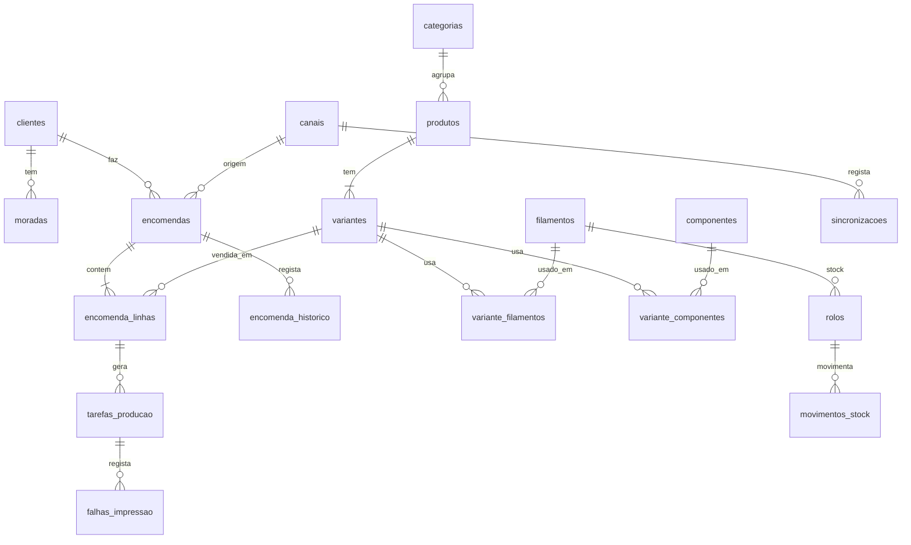

# CubicoDesign3D Backoffice — Documento do projeto

> Projeto principal do portfólio Flutter.
> Estado: **Fase 1 concluída · Fase 2 em validação**

| Fase | Tema | Estado |
|------|------|--------|
| 1 | Âmbito, arquitetura e ecrãs | ✅ Concluída |
| 2 | Esquema da base de dados | 🔍 Em validação |
| 3 | API em PHP | ⏳ |
| 4 | App Flutter em **modo demo**, por fatias (ver plano no fim) | ▶️ A começar |
| 5 | Módulos da v1, um a um | ⏳ |

## Resumo rápido (ler primeiro)

- **Ecrãs:** canvas com todos os ecrãs desenhados → https://claude.ai/artifact/7tKJPB8zAAbLTaaAYmsU61 · imagens JPG no projeto (pasta `ecras`).
- **Validados (9):** Login, Dashboard, Lista de encomendas, Detalhe da encomenda, Criar encomenda, Produtos e categorias, Produto e custos, Custos e preços, Produção.
- **Por desenhar:** Clientes; Definições (com gestão de utilizadores); versões do colaborador (sobretudo o dashboard operacional); Produção e Produtos no telemóvel.
- **Decisões em aberto:** estados das encomendas e da produção estão completos?; falta algum campo nas encomendas (embrulho, nota ao cliente…)?; versão do MySQL/MariaDB no cPanel; preço de compra real da Bambu Lab A1 (para o desgaste).
- **Decisões-chave:** Etsy entra sozinha; Instagram, Facebook e Pessoalmente registam-se em "Criar encomenda" (sem ficha de cliente obrigatória); dois papéis (administrador e colaborador — o colaborador nunca vê custos, lucros nem margens, mas pode alterar preços, ficando registado); API em PHP no cPanel; Flutter web + Android, iPhone pela versão web no Safari; luz a 0,21 €/kWh, A1 a 95 W; filamentos com preço normal e preço pago.
- **Forma de trabalhar:** o Rui escreve o código; o Claude explica, revê e ajuda. Plano por fatias no fim deste documento.

---

# FASE 1 — Âmbito, arquitetura e ecrãs

## 1. Visão geral

Backoffice para gerir toda a operação da CubicoDesign3D: catálogo, produção, encomendas, clientes, custos e resultados.

**Princípio central:** as encomendas da **Etsy entram sozinhas** — o dono da loja não as introduz, só as trata. As vendas feitas **pessoalmente, pelo Instagram ou pelo Facebook** são registadas no backoffice com "Criar encomenda", pelo dono ou por quem o ajuda na loja.

## 2. Marca

- Logotipo a preto e branco: ícone de impressora sobre cubo + "CubicoDesign3D" + slogan "transformamos ideias em volume".
- Versões preparadas (fundo transparente): `logo-branco.png`, `icone-branco.png`, `icone-preto.png` → vão para `app/assets/brand/`.
- Tipografia: **Poppins** (nome da marca e títulos de destaque), **Manrope** (interface), **JetBrains Mono** (valores, nº de encomenda, SKU).
- Cores: preto `#18181B` (menu), fundo `#F4F3EF`, destaque laranja `#C2410C` (provisório até haver cor oficial da marca).

## 3. Arquitetura

```
┌──────────────────────────────┐
│  Backoffice Flutter          │  Flutter web (PC) + Android
│  Riverpod · GoRouter         │
│  Dio · Freezed · fl_chart    │
└──────────────┬───────────────┘
               │ HTTPS / JSON (REST) + JWT
┌──────────────▼───────────────┐
│  API em PHP 8 (Slim)         │  regras de negócio, cálculos,
│  no cPanel                   │  sincronização (cron jobs)
└──────────────┬───────────────┘
               │
┌──────────────▼───────────────┐
│  MySQL / MariaDB (cPanel)    │
└──────────────────────────────┘
```

**Decisão:** o alojamento é partilhado (cPanel, só PHP). Por isso a API é em **PHP 8 com Slim** em vez de Dart. A app Flutter web é alojada no mesmo cPanel (ficheiros estáticos) → **custo extra zero**.

Regras:
- A app **nunca** liga diretamente ao MySQL; só a API conhece as credenciais.
- **A API faz as contas e as regras; o Flutter só mostra e envia ações.**
- **Modo demo**: repositórios com dados de exemplo locais, para a demo pública do portfólio.

Estrutura do repositório:

```
cubico_backoffice/
├── app/      # Flutter (feature-first)
├── api/      # PHP 8 + Slim
├── database/ # schema.sql, dados de exemplo
└── docs/     # este documento
```

## 4. De onde vêm as encomendas

| Canal | Como entra | Automático |
|-------|-----------|-----------|
| Etsy | API da Etsy (app de uso pessoal). Cron job no cPanel lê as encomendas de x em x minutos | ✅ |
| Loja online própria (v3) | Cada compra cria a encomenda diretamente na BD | ✅ |
| Instagram | "Criar encomenda" no backoffice, pelo dono ou por quem ajuda na loja | ✍️ |
| Facebook | "Criar encomenda" no backoffice | ✍️ |
| Pessoalmente (boca a boca, feiras, eventos) | "Criar encomenda" no backoffice, só com nome/referência (sem ficha de cliente) | ✍️ |

**Canais de venda:** Etsy (automático), Instagram, Facebook e Pessoalmente. A criação de encomendas no backoffice só mostra **Pessoalmente, Instagram e Facebook** — a Etsy nunca aparece lá, porque já está ligada. Loja online própria fica para a v3.

- A sincronização é **idempotente**: a mesma encomenda Etsy nunca entra duas vezes (chave única canal + referência externa).
- No ecrã aparece o estado da sincronização ("Etsy há 5 min · Loja há 2 min") e um botão "Sincronizar agora".

## 5. Módulos

### 5.1 Autenticação
- Login com email e palavra-passe (JWT emitido pela API). "Manter sessão". Botão "Explorar em modo demo".

### 5.1b Utilizadores e permissões

Dois papéis. **Quem ajuda na loja vê só a parte operacional — nunca custos, lucros nem margens.**

| Área | Administrador | Colaborador |
|------|:---:|:---:|
| Dashboard | Completo (vendas, lucro, margens) | **Operacional**: encomendas pendentes e atrasadas, fila de produção, alertas de filamento |
| Lista de encomendas | Tudo | Sem coluna Lucro (vê o Total, para saber quanto cobrar) |
| Detalhe da encomenda | Tudo | Sem o bloco Custos/Lucro; vê o que foi recebido |
| Criar encomenda | Botão discreto | **Botão principal**; resumo sem custo nem lucro estimados |
| Alterar o preço de um artigo (descontos) | ✅ | ✅ — fica registado no histórico e a encomenda aparece ao administrador com a marca "Preço alterado" |
| Mudar estados, envio, seguimento | ✅ | ✅ |
| Produção (kanban, falhas) | ✅ | ✅ |
| Produtos e categorias | Criar, editar, apagar | Só consultar: fotos, variantes, preço de venda (sem custo, margem nem calculadora) |
| Clientes | ✅ | Consultar |
| Custos e preços, Relatórios, Definições | ✅ | ❌ não aparecem no menu |
| Gestão de utilizadores | ✅ | ❌ |

Regras:
- **A API é que protege os dados**, não só os ecrãs: para um colaborador, a API nunca envia `custo_unit`, `taxa_canal`, `portes_pagos`, lucro nem margem. Esconder no Flutter não chega.
- Cada encomenda guarda **quem a criou**; cada mudança fica no histórico com o nome da pessoa.
- O administrador pode **desativar** uma conta sem a apagar (o histórico mantém o nome).

### 5.2 Dashboard
- Vendas, lucro, nº de encomendas e margem média do período, com comparação ao período anterior.
- Gráfico de vendas e lucro, vendas por canal, mais vendidos.
- Alertas: encomendas atrasadas, filamento com stock baixo, tarefas na fila.

### 5.3 Encomendas
- Lista com filtros por estado, canal, pagamento e período; destaque às atrasadas; paginação; exportar CSV.
- Detalhe: progresso, artigos e personalização, recebido vs. custos → **lucro real**, cliente, envio e código de seguimento, pagamento, notas internas, histórico.
- Estados:

```
Pendente → Em produção → Pronta → Enviada → Entregue
    └─────────────→ Cancelada
```

- **Criar encomenda**, em 5 passos: Origem (**Pessoalmente, Instagram ou Facebook**) → **Para quem?** (só um nome ou referência e contacto opcional — **não cria ficha de cliente**; pode, se quiseres, associar a um cliente existente) → Artigos (variante, qtd., preço editável, personalização) → Entrega (em mão, levantamento, CTT com morada e portes) → Pagamento e notas. Resumo com total, custo e lucro estimados.

### 5.4 Produtos
- **Lista de produtos com painel de Categorias** à esquerda: cada categoria mostra quantos produtos tem; tocar numa categoria filtra a lista.
- **Criar categoria:** campo "Nova categoria" + "Adicionar" no fundo do painel (a categoria recebe uma cor automática). **Editar e apagar:** o lápis ao lado de cada categoria abre a edição no próprio sítio — mudar o nome, escolher a cor e Guardar/Cancelar. "Apagar categoria" pede confirmação e **só aparece se a categoria não tiver produtos**; se tiver, a app diz quantos tem e pede para os mudar de categoria primeiro. Renomear atualiza logo todos os produtos dessa categoria. Arrastar para mudar a ordem.
- **Atribuir a um produto:** na ficha do produto, o campo Categoria é uma lista com as categorias existentes e a opção "+ Nova categoria…", para criar uma sem sair do produto.
- Cada produto tem **uma** categoria.
- Ficha: nome, SKU, categoria, descrição, fotos, estado (ativo / rascunho / arquivado).
- Variantes com SKU, preço, filamentos (tipo + gramas), tempo de impressão, nº de tabuleiros, ficheiro .3mf.
- Componentes e embalagem; packs (v2).
- **Calculadora de custo e margem ligada a Custos e preços** (nada é escrito à mão):
  - **Filamento** escolhido da lista (com o €/kg do preço pago) × gramas.
  - **Impressão**: horas × custo/h da impressora (luz + desgaste).
  - **Componentes** com **quantidade por unidade** (botões − e +; ex.: 4 ímanes no CubicoDesk), cada um com o seu custo e peso.
  - **Embalagem**: escolhida da lista (tocar para incluir), com o seu custo e peso.
  - **Canal**: taxas da Etsy, ou nenhuma para Instagram, Facebook e Pessoalmente.
  - **Preço de venda** com margem em tempo real (aviso abaixo da margem mínima) e **preço sugerido** pela margem alvo, já arredondado.
  - **Envio estimado**: peso da peça + embalagem → escalão e preço dos portes.
- Na tabela de variantes, o **custo de produção** de cada variante (filamento + impressão + componentes + embalagem, sem taxas nem portes).

### 5.5 Produção — como funciona

1. "Enviar para produção" numa encomenda → a API cria **tarefas de impressão** (uma por linha), com filamento e tempo vindos da ficha do produto.
2. Quadro kanban: **Por imprimir → A imprimir → Pós-processamento → Concluído**. Arrastar um cartão = pedido à API a mudar o estado da tarefa.
3. Ao concluir uma tarefa, a API **desconta as gramas** do stock de filamento.
4. Quando **todas** as tarefas de uma encomenda estão concluídas → a encomenda passa **sozinha** a "Pronta".
5. Falhas de impressão registam gramas e tempo perdidos, que entram nos custos.
6. Painel "Filamento necessário" compara o que a fila precisa com o stock.

**Progresso da impressora (v1):** botão "Iniciar impressão" e progresso calculado pelo tempo estimado. A ligação real à Bambu Lab A1 fica para mais tarde (a impressora comunica pela rede de casa, o cPanel está na internet).

### 5.6 Dashboard — como os gráficos ficam ligados no Flutter

O Flutter **não soma nada**. A API faz as contas no MySQL (`SUM`, `GROUP BY`) e devolve tudo num pedido:

```
GET /dashboard?periodo=mes
```

```json
{
  "vendas": 412.0, "lucro": 238.4, "encomendas": 27, "margem_media": 58,
  "comparacao": { "vendas": 18, "lucro": 22, "encomendas": -4 },
  "serie": [{ "dia": "2026-10-01", "vendas": 12.0, "lucro": 6.5 }],
  "canais": [{ "canal": "etsy", "total": 206.0 }],
  "top_produtos": [{ "nome": "Pack marinho flexi", "quantidade": 24 }],
  "alertas": { "atrasadas": 2, "stock_baixo": ["PLA preto mate"], "fila": 6 }
}
```

Caminho no Flutter:
- **Dio** faz o pedido → **Freezed** converte em `DashboardResumo` → **Riverpod** guarda num provider que depende do período → os widgets só desenham (**fl_chart** para os gráficos).

```dart
final dashboardProvider = FutureProvider.family<DashboardResumo, Periodo>(
  (ref, periodo) => ref.watch(dashboardRepoProvider).obter(periodo),
);

LineChartBarData(
  spots: [for (var i = 0; i < resumo.serie.length; i++)
    FlSpot(i.toDouble(), resumo.serie[i].vendas)],
)
```

Mudar o período → o provider volta a pedir sozinho. No modo demo, o repositório devolve dados de exemplo e o resto da app não dá pela diferença.

### 5.6b Custos e preços — onde ficam todos os custos

Ecrã único com 6 separadores. **Defines uma vez e a app usa estes valores em todos os cálculos** (calculadora do produto, custo de cada encomenda, lucro, preço sugerido). Alterar um valor **não mexe** no lucro de encomendas já feitas.

| Separador | O que defines | Como a app usa |
|-----------|---------------|----------------|
| **Energia e impressoras** | Preço do kWh do contrato; por impressora: consumo médio (W), preço de compra, vida útil (h), manutenção por ano, horas de impressão por ano | Calcula o **custo por hora** de impressão (eletricidade + desgaste) — com os valores reais: 95 W (média oficial da A1 em PLA) × 0,21 €/kWh (contrato, com IVA) ≈ 0,020 €/h de luz + 350 €/5000 h + 40 €/1500 h de desgaste ≈ **0,12 €/h** |
| **Filamentos** | Tipo, marca, cor, peso do rolo, **preço normal** e **preço pago** (com desconto/promoção), portes da compra | Calcula o **€/kg** com o preço pago; o normal fica como referência e mostra a poupança. **Adicionar e editar** num formulário próprio (tipo, marca, cor e amostra, peso do rolo, preço normal, preço pago, portes da compra e nº de rolos nessa compra), com pré-visualização do custo real |
| **Embalagens e componentes** | **Componentes** (vão dentro do produto: argolas, ímanes, parafusos, mosquetões…) e **embalagens** (sacos por tamanho, caixas, envelopes, papel, cartões, autocolantes). Botões "+ Componente" e "+ Embalagem" abrem um formulário: nome, tamanho, preço do pack, unidades no pack, peso por unidade; lápis para editar; filtro Todos/Componentes/Embalagens | Calcula o **custo por unidade**; em cada produto escolhes quais usa; o peso entra no escalão dos portes |
| **Portes de envio** | Por transportadora: zonas (Portugal Continental, Açores e Madeira, Europa, Resto do mundo) × escalões de peso | Calcula **quanto te custa enviar** cada encomenda pelo peso total e pela zona da morada |
| **Taxas** | Etsy (transação, processamento, fixo, listagem); Instagram, Facebook e Pessoalmente sem taxa; métodos de pagamento | Entra no custo de cada venda |
| **Margens e custos fixos** | Margem alvo e mínima, arredondamento de preços, valor da tua hora (opcional), custos fixos mensais (alojamento, Etsy Plus…) | Preço sugerido, aviso de margem baixa, e opção de repartir os custos fixos pelas encomendas |

Os valores mostrados nos ecrãs são **de exemplo**; os reais copiam-se da fatura da luz, das tabelas da transportadora e da conta Etsy.

**Custo completo de uma unidade:**

```
filamento   = Σ gramas × €/kg ÷ 1000
impressão   = horas × €/h da impressora (luz + desgaste)
embalagem   = Σ custo/un. dos componentes e embalagens
taxas       = preço × (% transação + % processamento) + fixo + listagem
mão de obra = minutos de pós-processamento × valor da hora (opcional)
```

**Por encomenda** soma-se ainda o envio real (tabela de portes) e, se ativado, a parte dos custos fixos.

### 5.7 Clientes
- Ficha com contactos, Instagram, moradas, histórico, total gasto, notas.

### 5.8 Stock (v2)
- Rolos de filamento com peso restante; desconto automático; alerta de mínimo. Componentes e embalagens.

### 5.9 Relatórios (v2)
- Vendas, lucro e custos por período, canal, produto e categoria; exportar CSV.

### 5.10 Definições
- Marca, canais e taxas, custos de energia e desgaste, transportadoras, categorias, utilizador.

## 6. Ecrãs desenhados (canvas "CubicoDesign3D Backoffice — Ecrãs")

| Ecrã | Plataforma | Estado |
|------|-----------|--------|
| Dashboard | Desktop + telemóvel | ✅ Aprovado (para já) |
| Lista de encomendas | Desktop + telemóvel | ✅ Aprovado |
| Detalhe da encomenda | Desktop + telemóvel | ✅ Aprovado |
| Criar encomenda manualmente | Desktop | ✅ Aprovado (pode ser ajustado mais tarde) |
| Produtos e categorias (lista + criar categoria) | Desktop | ✅ Aprovado |
| Produto e custos (calculadora interativa) | Desktop | ✅ Aprovado |
| Custos e preços (6 separadores) | Desktop | ✅ Aprovado |
| Produção (kanban) | Desktop | ✅ Aprovado |
| Login | Desktop | ✅ Aprovado |

Navegação: menu lateral no desktop (`NavigationRail` / `Drawer`), menu inferior no telemóvel (`NavigationBar`) com Início, Encomendas, Produção, Produtos.

## 7. Versões

| Versão | Inclui |
|--------|--------|
| **v1** | Login com dois papéis (administrador e colaborador), Dashboard, Produtos e variantes, Custos e preços, Encomendas (com sincronização Etsy e criação manual), Produção (kanban + criação automática de tarefas), Clientes, Definições básicas, Modo demo |
| **v2** | Stock de filamentos com desconto automático, Packs, Relatórios + CSV |
| **v3** | Loja online própria, revenda de filamentos/acessórios, ligação à impressora |

## 8. Critérios de conclusão da v1

- [ ] Login funcional e rotas protegidas.
- [ ] Colaborador nunca recebe custos, lucros nem margens da API.
- [ ] CRUD de produtos e variantes com custo e margem corretos.
- [ ] Encomendas Etsy a entrar sozinhas, sem duplicados.
- [ ] Criar encomenda manualmente.
- [ ] Mudar estados; histórico registado.
- [ ] Tarefas de produção criadas automaticamente; encomenda passa a "Pronta" sozinha.
- [ ] Dashboard com números que batem certo com os dados.
- [ ] Layout responsivo desktop + telemóvel.
- [ ] Modo demo publicado online.
- [ ] README com arquitetura, screenshots e link da demo.

---

# FASE 2 — Esquema da base de dados

## 1. Regras de desenho

- **MySQL 8 / MariaDB 10.4+**, motor **InnoDB**, `utf8mb4` (acentos e emojis nos nomes dos clientes).
- Dinheiro sempre em `DECIMAL(10,2)` — nunca `FLOAT`.
- Pesos em gramas (`INT`), tempos em minutos (`INT`).
- **Fotografia dos valores na venda:** cada linha de encomenda guarda o custo e a taxa **no momento da venda**. Se o preço do filamento mudar amanhã, o lucro das encomendas antigas não muda.
- Chave única `(canal_id, ref_externa)` em `encomendas` → a sincronização nunca cria duplicados.
- Nomes de tabelas e colunas em português, minúsculas, `snake_case`.
- **Encomendas sem ficha de cliente:** `cliente_id` é opcional. Encomendas "de boca" guardam só `cliente_nome` (e `cliente_contacto` se houver). As que vêm da Etsy/loja ligam-se a uma ficha em `clientes`.

## 2. Mapa das tabelas



## 3. Tabelas por área

| Área | Tabelas | Versão |
|------|---------|--------|
| Acesso | `utilizadores` | v1 |
| Configuração | `definicoes`, `canais`, `categorias`, `metodos_pagamento`, `custos_fixos` | v1 |
| Materiais e produção | `filamentos`, `componentes`, `impressoras` | v1 |
| Envios | `transportadoras`, `zonas_envio`, `tarifas_envio` | v1 |
| Catálogo | `produtos`, `produto_fotos`, `variantes`, `variante_filamentos`, `variante_componentes` | v1 |
| Clientes | `clientes`, `moradas` | v1 |
| Encomendas | `encomendas`, `encomenda_linhas`, `encomenda_historico`, `sincronizacoes` | v1 |
| Produção | `tarefas_producao`, `falhas_impressao` | v1 |
| Stock | `rolos`, `movimentos_stock` | v2 (já preparado) |
| Packs | `pack_itens` | v2 (já preparado) |

## 4. SQL (`database/schema.sql`)

```sql
SET NAMES utf8mb4;

-- ───────────── Acesso ─────────────
CREATE TABLE utilizadores (
  id            INT UNSIGNED AUTO_INCREMENT PRIMARY KEY,
  nome          VARCHAR(100) NOT NULL,
  email         VARCHAR(190) NOT NULL UNIQUE,
  password_hash VARCHAR(255) NOT NULL,
  papel         ENUM('admin','colaborador') NOT NULL DEFAULT 'colaborador',
  ativo         BOOLEAN NOT NULL DEFAULT TRUE,   -- desativar sem apagar
  ultimo_acesso DATETIME,
  criado_em     DATETIME NOT NULL DEFAULT CURRENT_TIMESTAMP
) ENGINE=InnoDB DEFAULT CHARSET=utf8mb4;

-- ───────────── Configuração ─────────────
CREATE TABLE definicoes (
  chave VARCHAR(60) PRIMARY KEY,           -- preco_kwh, margem_alvo, margem_minima, arredondamento, valor_hora, incluir_custos_fixos
  valor VARCHAR(255) NOT NULL
) ENGINE=InnoDB DEFAULT CHARSET=utf8mb4;

CREATE TABLE canais (
  id                TINYINT UNSIGNED AUTO_INCREMENT PRIMARY KEY,
  codigo            VARCHAR(20) NOT NULL UNIQUE, -- etsy, instagram, facebook, pessoalmente (+ loja na v3)
  nome              VARCHAR(60) NOT NULL,
  taxa_transacao    DECIMAL(5,2) NOT NULL DEFAULT 0,  -- %
  taxa_processamento DECIMAL(5,2) NOT NULL DEFAULT 0, -- %
  taxa_fixa         DECIMAL(10,2) NOT NULL DEFAULT 0, -- € por venda
  taxa_listagem     DECIMAL(10,2) NOT NULL DEFAULT 0, -- € por artigo vendido
  automatico        BOOLEAN NOT NULL DEFAULT FALSE    -- TRUE = encomendas entram sozinhas
) ENGINE=InnoDB DEFAULT CHARSET=utf8mb4;

CREATE TABLE categorias (
  id    SMALLINT UNSIGNED AUTO_INCREMENT PRIMARY KEY,
  nome  VARCHAR(60) NOT NULL UNIQUE,         -- Secretária, Chaveiros, Flexi, Packs…
  cor   CHAR(7) NOT NULL DEFAULT '#A1A1AA',   -- cor da etiqueta na app
  ordem SMALLINT UNSIGNED NOT NULL DEFAULT 0  -- ordem na lista (arrastar para ordenar)
) ENGINE=InnoDB DEFAULT CHARSET=utf8mb4;

-- ───────────── Materiais ─────────────
CREATE TABLE filamentos (
  id            SMALLINT UNSIGNED AUTO_INCREMENT PRIMARY KEY,
  tipo          VARCHAR(20) NOT NULL,           -- PLA, PLA Silk, PETG, TPU…
  marca         VARCHAR(60),
  cor           VARCHAR(60) NOT NULL,
  cor_hex       CHAR(7),
  peso_rolo_g   INT UNSIGNED NOT NULL DEFAULT 1000,
  preco_normal  DECIMAL(10,2) NOT NULL,          -- preço de tabela (referência)
  preco_pago    DECIMAL(10,2) NOT NULL,          -- o que pagaste, com desconto/promoção
  portes_compra DECIMAL(10,2) NOT NULL DEFAULT 0,  -- total de portes dessa compra
  rolos_compra  TINYINT UNSIGNED NOT NULL DEFAULT 1, -- portes repartidos por estes rolos
  -- €/kg = (preco_pago + portes_compra / rolos_compra) / peso_rolo_g × 1000  (calculado pela API)
  stock_min_g   INT UNSIGNED NOT NULL DEFAULT 250,
  ativo         BOOLEAN NOT NULL DEFAULT TRUE
) ENGINE=InnoDB DEFAULT CHARSET=utf8mb4;

CREATE TABLE componentes (
  id            SMALLINT UNSIGNED AUTO_INCREMENT PRIMARY KEY,
  nome          VARCHAR(100) NOT NULL,         -- saco zip, caixa, argola, íman…
  tipo          ENUM('componente','embalagem') NOT NULL,
  tamanho       VARCHAR(40),                   -- 8 × 12 cm, S, A5…
  peso_g        SMALLINT UNSIGNED NOT NULL DEFAULT 0, -- conta para o escalão dos portes
  preco_pack    DECIMAL(10,2) NOT NULL,
  unidades_pack INT UNSIGNED NOT NULL DEFAULT 1,
  -- custo/un. = preco_pack / unidades_pack  (calculado pela API)
  stock_qtd     INT NOT NULL DEFAULT 0,
  stock_min     INT NOT NULL DEFAULT 0
) ENGINE=InnoDB DEFAULT CHARSET=utf8mb4;

CREATE TABLE impressoras (
  id                  TINYINT UNSIGNED AUTO_INCREMENT PRIMARY KEY,
  nome                VARCHAR(60) NOT NULL,          -- Bambu Lab A1
  consumo_w           SMALLINT UNSIGNED NOT NULL,    -- consumo médio a imprimir
  preco_compra        DECIMAL(10,2) NOT NULL,
  vida_util_h         INT UNSIGNED NOT NULL,
  manutencao_ano      DECIMAL(10,2) NOT NULL DEFAULT 0,
  horas_ano           INT UNSIGNED NOT NULL DEFAULT 1000,
  principal           BOOLEAN NOT NULL DEFAULT FALSE
  -- €/h = consumo_w/1000 × preco_kwh + preco_compra/vida_util_h + manutencao_ano/horas_ano
) ENGINE=InnoDB DEFAULT CHARSET=utf8mb4;

CREATE TABLE transportadoras (
  id   TINYINT UNSIGNED AUTO_INCREMENT PRIMARY KEY,
  nome VARCHAR(60) NOT NULL                          -- CTT · Correio Registado, CTT Expresso…
) ENGINE=InnoDB DEFAULT CHARSET=utf8mb4;

CREATE TABLE zonas_envio (
  id     TINYINT UNSIGNED AUTO_INCREMENT PRIMARY KEY,
  nome   VARCHAR(60) NOT NULL,                       -- Portugal Continental, Europa · Zona 1…
  paises VARCHAR(500)                                -- códigos ISO, ex.: 'ES,FR,DE'
) ENGINE=InnoDB DEFAULT CHARSET=utf8mb4;

CREATE TABLE tarifas_envio (
  transportadora_id TINYINT UNSIGNED NOT NULL,
  zona_id           TINYINT UNSIGNED NOT NULL,
  peso_max_g        INT UNSIGNED NOT NULL,           -- escalão: até 20 g, 100 g, 500 g…
  preco             DECIMAL(10,2) NOT NULL,
  PRIMARY KEY (transportadora_id, zona_id, peso_max_g),
  FOREIGN KEY (transportadora_id) REFERENCES transportadoras(id) ON DELETE CASCADE,
  FOREIGN KEY (zona_id)           REFERENCES zonas_envio(id) ON DELETE CASCADE
) ENGINE=InnoDB DEFAULT CHARSET=utf8mb4;

CREATE TABLE metodos_pagamento (
  id          TINYINT UNSIGNED AUTO_INCREMENT PRIMARY KEY,
  nome        VARCHAR(40) NOT NULL,                  -- MB WAY, Transferência, Dinheiro
  taxa_percent DECIMAL(5,2) NOT NULL DEFAULT 0,
  taxa_fixa   DECIMAL(10,2) NOT NULL DEFAULT 0
) ENGINE=InnoDB DEFAULT CHARSET=utf8mb4;

CREATE TABLE custos_fixos (
  id          SMALLINT UNSIGNED AUTO_INCREMENT PRIMARY KEY,
  nome        VARCHAR(80) NOT NULL,                  -- Alojamento cPanel, Etsy Plus…
  valor_mes   DECIMAL(10,2) NOT NULL
) ENGINE=InnoDB DEFAULT CHARSET=utf8mb4;

-- ───────────── Catálogo ─────────────
CREATE TABLE produtos (
  id            INT UNSIGNED AUTO_INCREMENT PRIMARY KEY,
  nome          VARCHAR(120) NOT NULL,
  sku_base      VARCHAR(40) NOT NULL UNIQUE,
  descricao     TEXT,
  categoria_id  SMALLINT UNSIGNED,
  estado        ENUM('ativo','rascunho','arquivado') NOT NULL DEFAULT 'rascunho',
  personalizavel BOOLEAN NOT NULL DEFAULT FALSE,
  e_pack        BOOLEAN NOT NULL DEFAULT FALSE,
  criado_em     DATETIME NOT NULL DEFAULT CURRENT_TIMESTAMP,
  atualizado_em DATETIME NOT NULL DEFAULT CURRENT_TIMESTAMP ON UPDATE CURRENT_TIMESTAMP,
  FOREIGN KEY (categoria_id) REFERENCES categorias(id) ON DELETE SET NULL
) ENGINE=InnoDB DEFAULT CHARSET=utf8mb4;

CREATE TABLE produto_fotos (
  id         INT UNSIGNED AUTO_INCREMENT PRIMARY KEY,
  produto_id INT UNSIGNED NOT NULL,
  url        VARCHAR(255) NOT NULL,
  ordem      TINYINT UNSIGNED NOT NULL DEFAULT 0,
  FOREIGN KEY (produto_id) REFERENCES produtos(id) ON DELETE CASCADE
) ENGINE=InnoDB DEFAULT CHARSET=utf8mb4;

CREATE TABLE variantes (
  id                  INT UNSIGNED AUTO_INCREMENT PRIMARY KEY,
  produto_id          INT UNSIGNED NOT NULL,
  nome                VARCHAR(80) NOT NULL,   -- Preto mate, Laranja…
  sku                 VARCHAR(50) NOT NULL UNIQUE,
  preco_venda         DECIMAL(10,2) NOT NULL,
  tempo_impressao_min INT UNSIGNED NOT NULL DEFAULT 0,
  n_tabuleiros        TINYINT UNSIGNED NOT NULL DEFAULT 1,
  peso_g              SMALLINT UNSIGNED NOT NULL DEFAULT 0, -- peso da peça, para os portes
  impressora_id       TINYINT UNSIGNED,                     -- NULL = impressora principal
  ficheiro_3mf        VARCHAR(255),
  etsy_listing_id     VARCHAR(30),             -- para ligar a encomenda Etsy à variante
  ativo               BOOLEAN NOT NULL DEFAULT TRUE,
  FOREIGN KEY (produto_id) REFERENCES produtos(id) ON DELETE CASCADE
) ENGINE=InnoDB DEFAULT CHARSET=utf8mb4;

CREATE TABLE variante_filamentos (
  variante_id  INT UNSIGNED NOT NULL,
  filamento_id SMALLINT UNSIGNED NOT NULL,
  gramas       INT UNSIGNED NOT NULL,
  PRIMARY KEY (variante_id, filamento_id),
  FOREIGN KEY (variante_id)  REFERENCES variantes(id) ON DELETE CASCADE,
  FOREIGN KEY (filamento_id) REFERENCES filamentos(id)
) ENGINE=InnoDB DEFAULT CHARSET=utf8mb4;

CREATE TABLE variante_componentes (
  variante_id    INT UNSIGNED NOT NULL,
  componente_id  SMALLINT UNSIGNED NOT NULL,
  quantidade     SMALLINT UNSIGNED NOT NULL DEFAULT 1,
  PRIMARY KEY (variante_id, componente_id),
  FOREIGN KEY (variante_id)   REFERENCES variantes(id) ON DELETE CASCADE,
  FOREIGN KEY (componente_id) REFERENCES componentes(id)
) ENGINE=InnoDB DEFAULT CHARSET=utf8mb4;

CREATE TABLE pack_itens (                      -- v2
  pack_variante_id INT UNSIGNED NOT NULL,
  variante_id      INT UNSIGNED NOT NULL,
  quantidade       SMALLINT UNSIGNED NOT NULL DEFAULT 1,
  PRIMARY KEY (pack_variante_id, variante_id),
  FOREIGN KEY (pack_variante_id) REFERENCES variantes(id) ON DELETE CASCADE,
  FOREIGN KEY (variante_id)      REFERENCES variantes(id)
) ENGINE=InnoDB DEFAULT CHARSET=utf8mb4;

-- ───────────── Clientes ─────────────
CREATE TABLE clientes (
  id         INT UNSIGNED AUTO_INCREMENT PRIMARY KEY,
  nome       VARCHAR(120) NOT NULL,
  email      VARCHAR(190),
  telefone   VARCHAR(30),
  instagram  VARCHAR(60),
  notas      TEXT,
  criado_em  DATETIME NOT NULL DEFAULT CURRENT_TIMESTAMP,
  INDEX (email)
) ENGINE=InnoDB DEFAULT CHARSET=utf8mb4;

CREATE TABLE moradas (
  id            INT UNSIGNED AUTO_INCREMENT PRIMARY KEY,
  cliente_id    INT UNSIGNED NOT NULL,
  linha1        VARCHAR(150) NOT NULL,
  linha2        VARCHAR(150),
  codigo_postal VARCHAR(12) NOT NULL,
  localidade    VARCHAR(80) NOT NULL,
  pais          CHAR(2) NOT NULL DEFAULT 'PT',
  FOREIGN KEY (cliente_id) REFERENCES clientes(id) ON DELETE CASCADE
) ENGINE=InnoDB DEFAULT CHARSET=utf8mb4;

-- ───────────── Encomendas ─────────────
CREATE TABLE encomendas (
  id                INT UNSIGNED AUTO_INCREMENT PRIMARY KEY,
  numero            INT UNSIGNED NOT NULL UNIQUE,      -- #1042
  canal_id          TINYINT UNSIGNED NOT NULL,
  ref_externa       VARCHAR(40),                       -- nº da encomenda na Etsy
  cliente_id        INT UNSIGNED,                      -- NULL = encomenda "de boca", sem ficha
  cliente_nome      VARCHAR(120) NOT NULL,             -- nome ou referência ("D. Lurdes — vizinha")
  cliente_contacto  VARCHAR(60),                       -- telemóvel ou @instagram, opcional
  morada_id         INT UNSIGNED,
  estado            ENUM('pendente','em_producao','pronta','enviada','entregue','cancelada')
                    NOT NULL DEFAULT 'pendente',
  estado_pagamento  ENUM('por_pagar','pago','reembolsado') NOT NULL DEFAULT 'por_pagar',
  metodo_pagamento  VARCHAR(30),                       -- Etsy Payments, MB WAY, dinheiro…
  metodo_entrega    ENUM('ctt','mao','levantamento','outro')   -- 'mao' = entrega em mão NOT NULL DEFAULT 'ctt',
  transportadora    VARCHAR(40),
  codigo_seguimento VARCHAR(40),
  portes_cobrados   DECIMAL(10,2) NOT NULL DEFAULT 0,
  portes_pagos      DECIMAL(10,2) NOT NULL DEFAULT 0,
  prazo_envio       DATE,
  notas             TEXT,
  criada_manual     BOOLEAN NOT NULL DEFAULT FALSE,
  criada_por        INT UNSIGNED,                      -- utilizador que a criou (NULL = Etsy/sincronização)
  vista             BOOLEAN NOT NULL DEFAULT FALSE,    -- "2 novas por ver"
  criada_em         DATETIME NOT NULL DEFAULT CURRENT_TIMESTAMP,
  atualizada_em     DATETIME NOT NULL DEFAULT CURRENT_TIMESTAMP ON UPDATE CURRENT_TIMESTAMP,
  UNIQUE KEY uq_origem (canal_id, ref_externa),        -- sem duplicados na sincronização
  INDEX (estado),
  INDEX (criada_em),
  FOREIGN KEY (canal_id)   REFERENCES canais(id),
  FOREIGN KEY (cliente_id) REFERENCES clientes(id) ON DELETE SET NULL,
  FOREIGN KEY (morada_id)  REFERENCES moradas(id) ON DELETE SET NULL,
  FOREIGN KEY (criada_por) REFERENCES utilizadores(id) ON DELETE SET NULL
) ENGINE=InnoDB DEFAULT CHARSET=utf8mb4;

CREATE TABLE encomenda_linhas (
  id              INT UNSIGNED AUTO_INCREMENT PRIMARY KEY,
  encomenda_id    INT UNSIGNED NOT NULL,
  variante_id     INT UNSIGNED NOT NULL,
  quantidade      SMALLINT UNSIGNED NOT NULL DEFAULT 1,
  preco_unit      DECIMAL(10,2) NOT NULL,
  desconto        DECIMAL(10,2) NOT NULL DEFAULT 0,
  personalizacao  VARCHAR(255),
  custo_unit      DECIMAL(10,2) NOT NULL,   -- fotografia do custo no momento da venda
  taxa_canal      DECIMAL(10,2) NOT NULL DEFAULT 0, -- fotografia da taxa desta linha
  FOREIGN KEY (encomenda_id) REFERENCES encomendas(id) ON DELETE CASCADE,
  FOREIGN KEY (variante_id)  REFERENCES variantes(id)
) ENGINE=InnoDB DEFAULT CHARSET=utf8mb4;

CREATE TABLE encomenda_historico (
  id            INT UNSIGNED AUTO_INCREMENT PRIMARY KEY,
  encomenda_id  INT UNSIGNED NOT NULL,
  descricao     VARCHAR(150) NOT NULL,      -- "Pagamento confirmado", "Enviada por CTT"…
  estado_novo   VARCHAR(20),
  origem        ENUM('sistema','utilizador','sincronizacao') NOT NULL,
  utilizador_id INT UNSIGNED,
  criado_em     DATETIME NOT NULL DEFAULT CURRENT_TIMESTAMP,
  FOREIGN KEY (encomenda_id)  REFERENCES encomendas(id) ON DELETE CASCADE,
  FOREIGN KEY (utilizador_id) REFERENCES utilizadores(id) ON DELETE SET NULL
) ENGINE=InnoDB DEFAULT CHARSET=utf8mb4;

CREATE TABLE sincronizacoes (
  id              INT UNSIGNED AUTO_INCREMENT PRIMARY KEY,
  canal_id        TINYINT UNSIGNED NOT NULL,
  iniciada_em     DATETIME NOT NULL DEFAULT CURRENT_TIMESTAMP,
  terminada_em    DATETIME,
  estado          ENUM('a_correr','ok','erro') NOT NULL DEFAULT 'a_correr',
  novas           SMALLINT UNSIGNED NOT NULL DEFAULT 0,
  atualizadas     SMALLINT UNSIGNED NOT NULL DEFAULT 0,
  erro            TEXT,
  FOREIGN KEY (canal_id) REFERENCES canais(id)
) ENGINE=InnoDB DEFAULT CHARSET=utf8mb4;

-- ───────────── Produção ─────────────
CREATE TABLE tarefas_producao (
  id                  INT UNSIGNED AUTO_INCREMENT PRIMARY KEY,
  encomenda_linha_id  INT UNSIGNED,          -- NULL = tarefa manual (stock, protótipo)
  variante_id         INT UNSIGNED NOT NULL,
  quantidade          SMALLINT UNSIGNED NOT NULL DEFAULT 1,
  estado              ENUM('por_imprimir','a_imprimir','pos_processamento','concluida')
                      NOT NULL DEFAULT 'por_imprimir',
  tempo_estimado_min  INT UNSIGNED NOT NULL,
  tabuleiro_atual     TINYINT UNSIGNED NOT NULL DEFAULT 0,
  iniciada_em         DATETIME,             -- usado para calcular o progresso na v1
  concluida_em        DATETIME,
  ordem               INT NOT NULL DEFAULT 0, -- posição no quadro
  notas               VARCHAR(255),
  INDEX (estado),
  FOREIGN KEY (encomenda_linha_id) REFERENCES encomenda_linhas(id) ON DELETE CASCADE,
  FOREIGN KEY (variante_id)        REFERENCES variantes(id)
) ENGINE=InnoDB DEFAULT CHARSET=utf8mb4;

CREATE TABLE falhas_impressao (
  id               INT UNSIGNED AUTO_INCREMENT PRIMARY KEY,
  tarefa_id        INT UNSIGNED NOT NULL,
  filamento_id     SMALLINT UNSIGNED NOT NULL,
  gramas_perdidas  INT UNSIGNED NOT NULL,
  minutos_perdidos INT UNSIGNED NOT NULL,
  motivo           VARCHAR(150),
  criado_em        DATETIME NOT NULL DEFAULT CURRENT_TIMESTAMP,
  FOREIGN KEY (tarefa_id)    REFERENCES tarefas_producao(id) ON DELETE CASCADE,
  FOREIGN KEY (filamento_id) REFERENCES filamentos(id)
) ENGINE=InnoDB DEFAULT CHARSET=utf8mb4;

-- ───────────── Stock (v2, já preparado) ─────────────
CREATE TABLE rolos (
  id              INT UNSIGNED AUTO_INCREMENT PRIMARY KEY,
  filamento_id    SMALLINT UNSIGNED NOT NULL,
  peso_inicial_g  INT UNSIGNED NOT NULL DEFAULT 1000,
  peso_restante_g INT NOT NULL,
  estado          ENUM('fechado','em_uso','acabado') NOT NULL DEFAULT 'fechado',
  comprado_em     DATE,
  FOREIGN KEY (filamento_id) REFERENCES filamentos(id)
) ENGINE=InnoDB DEFAULT CHARSET=utf8mb4;

CREATE TABLE movimentos_stock (
  id        INT UNSIGNED AUTO_INCREMENT PRIMARY KEY,
  rolo_id   INT UNSIGNED NOT NULL,
  gramas    INT NOT NULL,                   -- negativo = consumo, positivo = acerto
  tipo      ENUM('producao','falha','acerto') NOT NULL,
  tarefa_id INT UNSIGNED,
  criado_em DATETIME NOT NULL DEFAULT CURRENT_TIMESTAMP,
  FOREIGN KEY (rolo_id)   REFERENCES rolos(id) ON DELETE CASCADE,
  FOREIGN KEY (tarefa_id) REFERENCES tarefas_producao(id) ON DELETE SET NULL
) ENGINE=InnoDB DEFAULT CHARSET=utf8mb4;
```

## 5. Como as tabelas servem cada ecrã

| Ecrã | Tabelas principais |
|------|-------------------|
| Dashboard | `encomendas` + `encomenda_linhas` (vendas, lucro), `canais`, `tarefas_producao`, `filamentos` |
| Lista de encomendas | `encomendas`, `clientes`, `canais` |
| Detalhe da encomenda | `encomendas`, `encomenda_linhas`, `variantes`, `clientes`, `moradas`, `encomenda_historico` |
| Criar manualmente | `clientes`, `variantes`, `canais` → grava em `encomendas` + `encomenda_linhas` |
| Produto e custos | `produtos`, `variantes`, `variante_filamentos`, `filamentos`, `variante_componentes`, `componentes`, `definicoes`, `canais` |
| Produção | `tarefas_producao`, `variantes`, `encomenda_linhas`, `filamentos` |
| Estado da sincronização | `sincronizacoes` |

**Lucro de uma encomenda** (calculado pela API):

```
recebido = Σ(preco_unit × quantidade − desconto) + portes_cobrados
custos   = Σ(custo_unit × quantidade) + Σ taxa_canal + portes_pagos
lucro    = recebido − custos
```

## 6. Por validar

- [ ] Os estados das encomendas e das tarefas estão completos?
- [ ] Falta algum campo que uses hoje nas encomendas (ex.: oferta, embrulho)?
- [ ] Confirmar a versão do MySQL/MariaDB no cPanel (aparece no phpMyAdmin).


---

# PLANO DE CONSTRUÇÃO EM FLUTTER

**Forma de trabalhar:** o código é escrito por mim (Rui); o Claude explica, revê e ajuda quando encravo. Uma fatia de cada vez, sempre a funcionar no fim.

**Primeiro só Flutter, em modo demo** (dados de exemplo em memória, sem backend). A API em PHP entra depois, trocando só os repositórios.

| Fatia | O que se constrói | O que se aprende |
|------:|-------------------|------------------|
| 0 | Projeto, pacotes, pastas, tema (cores e letras da marca), Git | Organizar um projeto real |
| 1 | Esqueleto: menu lateral (PC) / menu inferior (telemóvel), ecrãs vazios | Layout responsivo, GoRouter com `ShellRoute` |
| 2 | Modelos (produto, variante, categoria, filamento…) + dados demo | Freezed, json_serializable, repositórios |
| 3 | Produtos e categorias (criar, editar, apagar, filtrar) | Riverpod: estado, listas, CRUD em memória |
| 4 | Ficha do produto + calculadora de custo | Estado derivado, formulários, **testes unitários** das contas |
| 5 | Custos e preços (6 separadores) | Formulários maiores, `TabBar`, validação |
| 6 | Encomendas: lista com filtros e detalhe | Listas grandes, filtros, navegação com parâmetros |
| 7 | Criar encomenda | Formulários dinâmicos, campos condicionais |
| 8 | Produção (kanban) | Drag and drop, regras de estado |
| 9 | Dashboard | fl_chart, estados de carregamento/erro |
| 10 | Login e papéis (administrador/colaborador) | Rotas protegidas, redirecionamentos |
| 11 | Ligar à API real | Dio, JWT, interceptores, tratamento de erros |

### Fatia 0 — tarefas

- [ ] `flutter create cubico_backoffice --platforms=web,android,ios`
  - iPhone: até haver Mac, usa-se a versão web no Safari ("Adicionar ao ecrã principal"); a app iOS nativa só se compila num Mac com Xcode
- [ ] Pacotes com `flutter pub add` (versões mais recentes): `flutter_riverpod`, `go_router`, `freezed_annotation`, `json_annotation`, `google_fonts`; dev: `build_runner`, `freezed`, `json_serializable`
- [ ] Estrutura de pastas feature-first
- [ ] Tema com as cores (#18181B, #F4F3EF, #C2410C) e as letras (Manrope, Poppins, JetBrains Mono)
- [ ] GoRouter com duas rotas de teste (`/dashboard`, `/encomendas`)
- [ ] Repositório Git + primeiro commit
- [ ] Testar no iPhone pela rede de casa: `flutter run -d web-server --web-hostname 0.0.0.0 --web-port 8080` e abrir `http://IP-do-PC:8080` no Safari (mesma rede Wi-Fi)

**iPhone (versão web):** ícone da marca em `web/icons` e `web/manifest.json`, nome curto "Cubico", abrir em ecrã inteiro (`display: standalone`); testar cada fatia também no Safari do iPhone.
